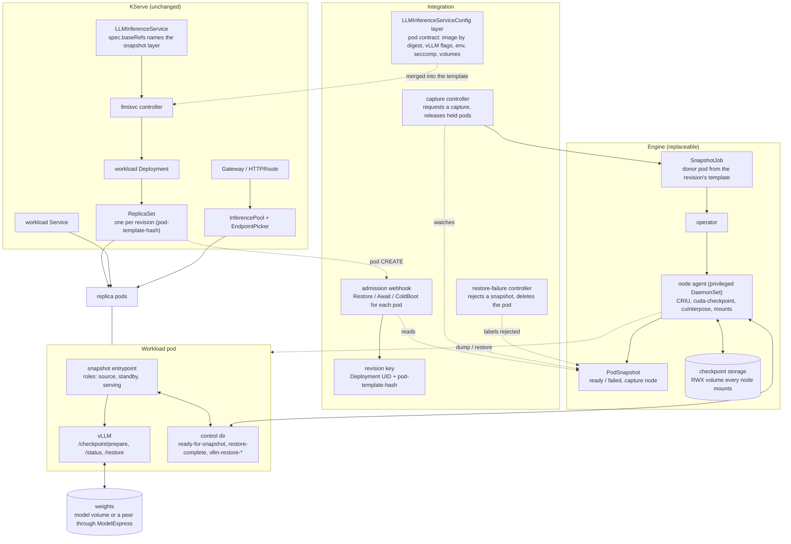
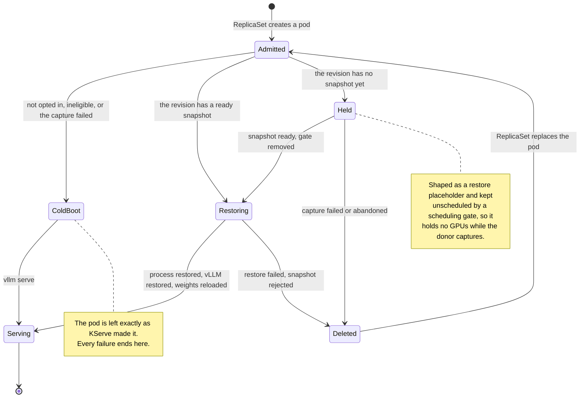
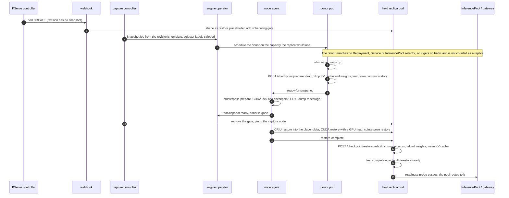
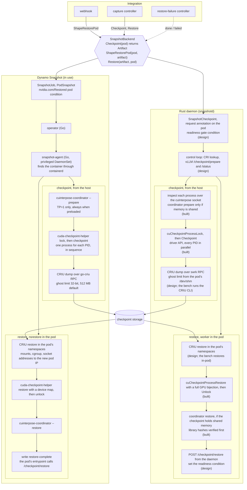

# What KServe has to lifecycle for snapshot scale-out

A map of every object, decision and hand-off between an `LLMInferenceService` and a replica that
serves from a checkpoint, as the proof of concept does it today with Dynamo Snapshot. Each piece
is marked by who owns it, so the same map says what stays and what is replaced if the snapshot
engine changes (see [DESIGN.md](DESIGN.md) for the Rust daemon that would replace it, and [`daemon/`](daemon) for the part of it that exists).

Three owners:

- **KServe**: objects KServe already creates and reconciles. Nothing here changes.
- **Integration**: the companion in [`kserve-dynamo-snapshot`](https://github.com/wseaton/kserve-dynamo-snapshot)
  and the config layer. It decides; it does not touch processes. Engine-neutral except where it
  builds or reads the engine's objects.
- **Engine**: whatever dumps and restores the process. Today Dynamo Snapshot's operator, its
  CRDs and its privileged node agent.

## Components

## One pod's path

Every workload pod of an opted-in service goes through admission once. The outcome depends only
on the state of its revision.

## First scale-up of a revision: capture, then restore

Later replicas of the same revision skip steps 3 to 11: the webhook finds the ready snapshot and
shapes the pod for restore directly, on any node that mounts the checkpoint storage.

## What has to be lifecycled

| # | Concern | What happens today | Owner | If the engine changes |
| --- | --- | --- | --- | --- |
| 1 | Opt-in | A service names the config layer in `spec.baseRefs`; the layer labels its pods `snapshot.neuralmagic.com/enabled` | Integration | stays |
| 2 | Eligibility | Refused, and cold-booted: prefill/decode or multi-node services, vLLM KV events, precise prefix-cache routing in the EndpointPicker, KV cache offloading | Integration | stays; the list is about vLLM and routing state, not the engine |
| 3 | Revision identity | Deployment UID plus `pod-template-hash` names the snapshot; any template change is a new revision and a new capture | Integration | stays |
| 4 | Pod contract | Image pinned by digest, `--enable-sleep-mode --checkpoint-release-weights`, `spawn` workers, `io_uring` blocked by seccomp, `HOME` on `/dev/shm`, pod identity through a downward API volume, cuInterpose volume and installer at TP>1 | Integration, to the engine's rules | shrinks: the entrypoint wrapper and its control files go if the engine calls vLLM's routes itself |
| 5 | Admission decision | Restore, Await or ColdBoot for each pod; never denies a pod | Integration | stays |
| 6 | Capacity during capture | The first replica is held unscheduled so the donor can use its GPUs, then pinned to the node the donor freed | Integration | stays |
| 7 | Donor isolation | Donor pod is the revision's template with every Deployment, Service and InferencePool selector label removed | Integration | stays |
| 8 | Capture request and status | `SnapshotJob` created, `PodSnapshot` watched for ready or failed | Integration calls engine | replaced: one `Checkpoint` call on a backend interface |
| 9 | Quiesce | The entrypoint warms vLLM up, calls `/checkpoint/prepare`, waits for `prepared`, signals the agent through a file | Pod, for the engine | moves into the engine if it drives vLLM's routes |
| 10 | Process dump | CRIU with the CUDA state checkpointed first; cuInterpose when workers share GPU memory | Engine | replaced |
| 11 | Checkpoint storage | A volume every node mounts; the image excludes the weights | Engine | replaced or reused; placement and retention are open |
| 12 | Restore placeholder | Pod shaped at admission: inert PID 1, startup gate, same mounts as the donor | Integration, to the engine's rules | replaced: `ShapeRestorePod` on the backend |
| 13 | Process restore | CRIU restore into the placeholder's namespaces and cgroup, CUDA restore onto the new pod's GPUs, socket addresses remapped to the new pod IP | Engine | replaced |
| 14 | Engine-level restore | `/checkpoint/restore`: communicators, weights, KV cache, CUDA graphs | vLLM, called from the pod | stays; the caller moves |
| 15 | Weights | Reloaded from the model volume, or pulled from a serving replica through ModelExpress; the replica then publishes itself under its own pod identity | vLLM + ModelExpress | stays |
| 16 | Readiness | Probe requires the restore-ready file and a passing `/health`; only then do the Service and InferencePool route to the pod | Integration | becomes a readiness gate condition the engine sets |
| 17 | Capture failure | The revision cold-boots: held pods are deleted and their replacements are left alone | Integration | stays |
| 18 | Restore failure | The snapshot is labelled rejected so admission stops choosing it, and the pod is deleted so its replacement cold-boots. Pods the kubelet rejected before any container started are ignored | Integration reads the engine's condition | stays; the failure signal changes |
| 19 | Garbage collection | The `SnapshotJob` is owned by the Deployment, so snapshots go when the service does. Snapshots of old revisions are not pruned | Integration + engine | open in both designs |
| 20 | Node compatibility | A snapshot restores on nodes with the same GPU model and a compatible driver; TP>1 through cuInterpose needs the CUDA 13.1 `libcuda` on 580 hosts | Engine checks, nobody schedules on it | open: the scheduler does not know which nodes can take a snapshot |
| 21 | Observability | Restore progress, errors and timings are files in the pod's control dir; capture timings are in the agent's log | Pod + engine | becomes pod conditions and events |

## The engine boundary

Rows 8, 10 to 13 and the signals in 16 and 18 are the whole surface between the integration and
the engine. DESIGN.md names it as an interface with three calls. Behind it, both engines run the
same three tools in the same order; they differ in who drives them and how.

What each tool is for, and why the order is fixed:

```mermaid
flowchart LR
  subgraph PREP["vLLM, before"]
    V1["/checkpoint/prepare<br/>drain, drop KV cache and weights,<br/>tear down communicators"]
  end
  subgraph CK["checkpoint"]
    direction LR
    C1["cuInterpose<br/>unmap GPU memory shared<br/>between processes, save how<br/>to re-import it"]
    C2["cuda-checkpoint<br/>lock every process, then copy<br/>each one's GPU state into<br/>its host memory"]
    C3["CRIU<br/>dump the process tree: memory,<br/>files, sockets, namespaces"]
    C1 --> C2 --> C3
  end
  subgraph RS["restore"]
    direction LR
    S1["CRIU<br/>recreate the tree in the<br/>new pod's namespaces"]
    S2["cuda-checkpoint<br/>move GPU state back, onto<br/>the new pod's GPUs, unlock"]
    S3["cuInterpose<br/>re-export and re-import<br/>the shared memory"]
    S1 --> S2 --> S3
  end
  subgraph POST["vLLM, after"]
    V2["/checkpoint/restore<br/>communicators, weights,<br/>KV cache, CUDA graphs"]
  end
  V1 --> C1
  C3 --> IMG[("image")]
  IMG --> S1
  S3 --> V2
```

- **cuInterpose** is needed only while processes still share GPU memory at checkpoint time: the
  driver cannot checkpoint a mapping another process holds. It is an `LD_PRELOAD` library plus a
  coordinator, and at TP>1 its restore needs the CUDA 13.1 `libcuda` on 580 hosts. With
  `patches/vllm/0003` nothing is shared after prepare, and both of its boxes drop out.
- **cuda-checkpoint** must finish before CRIU starts, because CRIU cannot dump device memory or
  the driver's mappings; after it, a GPU process looks like a CPU process to CRIU. On restore the
  order reverses: the process must exist before its GPU state can come back.
- **CRIU** does everything else, and is where the image size and most of the dump time go.

## Where the privilege lives

Checkpointing a process and recreating it somewhere else is privileged work whoever does it: CRIU
reads another process's memory and file table, recreates PIDs, mounts and sockets, and on restore
enters the target pod's namespaces and cgroup. The choice is not whether something runs with root
or its capabilities, but which component does, and how many copies of it there are.

| | Node agent (this design, and Dynamo Snapshot) | Wrapper in every workload pod | Kubelet and container runtime |
| --- | --- | --- | --- |
| Who runs CRIU | one DaemonSet pod per GPU node, in its own namespace | a wrapper injected as PID 1 of every vLLM container, which spawns vLLM and later dumps or restores it | the container runtime, on a kubelet checkpoint request |
| What is privileged | the agent: `privileged`, `hostPID`, host paths for the runtime socket, kubelet pod dirs, `/proc` and cgroups | every workload container: `CAP_CHECKPOINT_RESTORE` and `CAP_SYS_PTRACE` at the least, `CAP_SYS_ADMIN` and `CAP_NET_ADMIN` for much of what CRIU restores, and a seccomp profile wide enough for CRIU | nothing new: the runtime is already root |
| Workload pod | unprivileged: non-root, all capabilities dropped, `io_uring` blocked by seccomp. KServe's hardened container is kept | carries the capabilities above next to model code, tokenizers and `--trust-remote-code` | unprivileged |
| Change to every deployment | a restore placeholder shaped at admission. Dynamo's path also wraps `vllm serve` in an unprivileged entrypoint; the Rust daemon design removes it | the entrypoint of every pod is replaced, and the wrapper stays PID 1 for the pod's life | none to the pod; restore means starting a container from a checkpoint image |
| Who must be trusted | one image and its RBAC, installed by the platform team | every image that runs with those capabilities, in every tenant namespace | the runtime |
| Pod Security | one namespace at the `privileged` level | every serving namespace needs an exception from `restricted` and `baseline` | none |
| GPU handling | the agent orders cuInterpose, cuda-checkpoint and CRIU, and maps GPUs to the new pod's | the wrapper must do the same from inside the pod | CRIU's CUDA plugin; no hook for the ordering or for a GPU map |

So yes: the alternative to a privileged node agent is a wrapper in every vLLM pod, and it is the
more invasive of the two. It does not remove the privilege. It moves it out of one component the
platform owns into every container that runs user-selected model code, multiplies it by the
number of replicas, and makes every serving namespace a Pod Security exception. A container
escape from a model server then starts with checkpoint and ptrace capabilities; with the node
agent it starts with none.

This is not hypothetical. [snapshot-orchestrator](https://github.com/neuralmagic/snapshot-orchestrator)
started as the in-pod design: a supervisor was PID 1 of the vLLM container, its image carried CRIU
and `cuda-checkpoint`, and the orchestrator ran checkpoints by exec-ing into the workload pods.
CRIU has only the privileges of the container it runs in, so the vLLM container itself ran
`privileged` with `SYS_ADMIN`, `CHECKPOINT_RESTORE` and `IPC_LOCK`: the model server held the
rights to recreate arbitrary processes and remount its own filesystem. Its README listed that as
a prototype limitation and planned the node agent to "remove both the supervisor and privileged
workload Pods", which commit `847c4a7` did; the workload went back to vLLM unprivileged as PID 1.

The same README weighed two more options. A privileged sidecar with a shared process namespace
removes the custom PID 1 but keeps a privileged container in every pod. Teaching vLLM to persist
its own state removes CRIU, but its sleep mode has no durable storage. Beyond the privileges, the
operational cost counted against anything in-pod: every deployment's entrypoint and image is
replaced, so each serving runtime, vLLM version and KServe template needs its own patched variant
kept in step with upstream.

What the node agent costs, stated plainly: it is root on every GPU node, it can read the memory
of any process there, and a bug in it is a node compromise. Ways to bound that, as requirements
on the daemon and not yet built:

- Run it only on GPU nodes that serve snapshotted workloads, in its own namespace, and have it act
  only on pods the integration has labelled and that a request names.
- Limit its RBAC to reading pods and writing its own objects and one pod condition.
- Keep the privileged part small. DESIGN.md has a single-threaded worker forked for each job do
  the namespace entry and the CRIU call, so the long-lived control loop never enters a workload's
  namespaces. Dynamo's agent also sets `hostNetwork` and `hostIPC`; whether the daemon can drop
  them is open.
- Protect checkpoint storage like the model's own data: images contain process memory. This holds
  for every column of the table.

What was and was not checked here: Dynamo's agent settings are from its Helm chart, and the
unprivileged workload pod is what the end-to-end runs used. The in-pod wrapper was run in
snapshot-orchestrator, not in this proof of concept; the wider capability list is CRIU's
documented requirement. The kubelet checkpoint path was not evaluated. Only the CUDA and cuInterpose parts of the Rust daemon
are built.

Everything left of the interface is about KServe's objects and vLLM's state, and carries over.
What a new engine must supply: a way to dump a quiesced pod and report where the artifact is, a
pod shape it can restore into, a restore that ends with the process running in the new pod's
namespaces on the new pod's GPUs, and a signal for done or failed.
