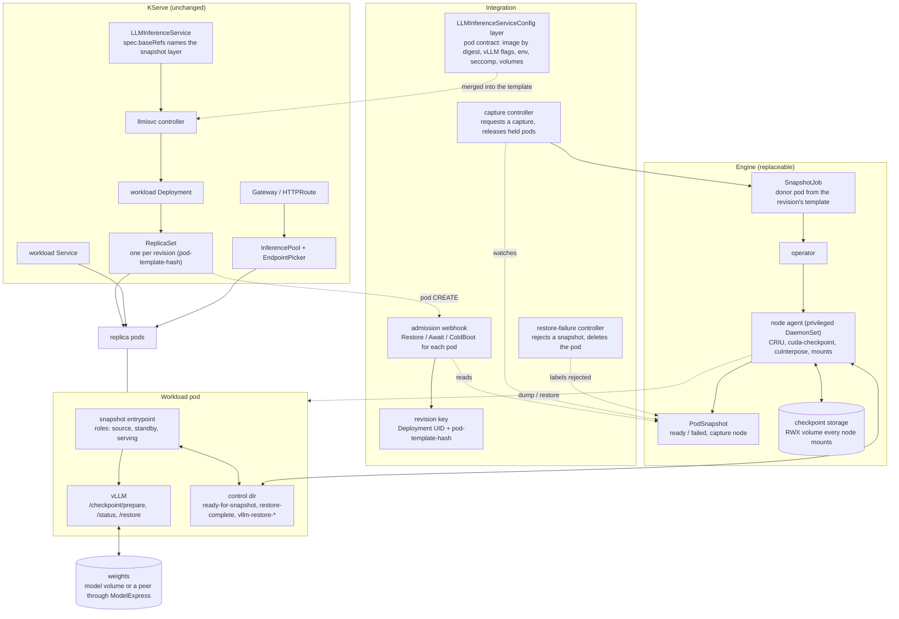
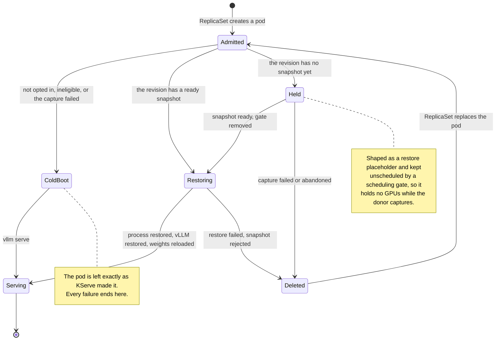
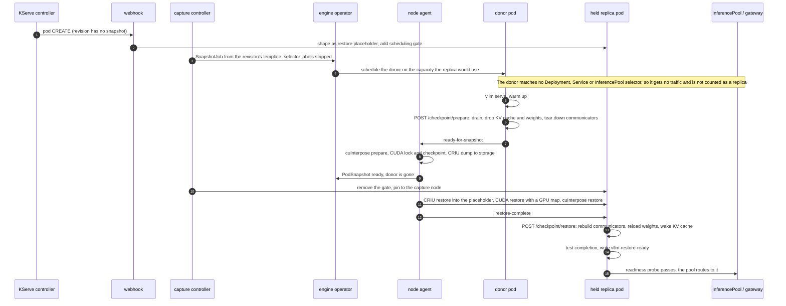
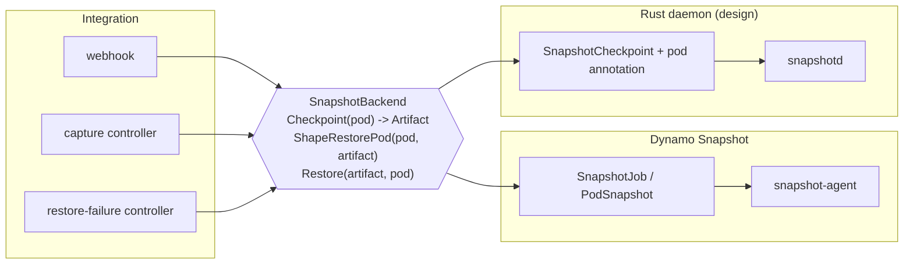

# What KServe has to lifecycle for snapshot scale-out

A map of every object, decision and hand-off between an `LLMInferenceService` and a replica that
serves from a checkpoint, as the proof of concept does it today with Dynamo Snapshot. Each piece
is marked by who owns it, so the same map says what stays and what is replaced if the snapshot
engine changes (see [DESIGN.md](DESIGN.md) for the Rust daemon that would replace it, and [`daemon/`](daemon) for the part of it that exists).

Three owners:

- **KServe**: objects KServe already creates and reconciles. Nothing here changes.
- **Integration**: the companion in [`kserve-dynamo-snapshot`](https://github.com/wseaton/kserve-dynamo-snapshot)
  and the config layer. It decides; it does not touch processes. Engine-neutral except where it
  builds or reads the engine's objects.
- **Engine**: whatever dumps and restores the process. Today Dynamo Snapshot's operator, its
  CRDs and its privileged node agent.

## Components

## One pod's path

Every workload pod of an opted-in service goes through admission once. The outcome depends only
on the state of its revision.

## First scale-up of a revision: capture, then restore

Later replicas of the same revision skip steps 3 to 11: the webhook finds the ready snapshot and
shapes the pod for restore directly, on any node that mounts the checkpoint storage.

## What has to be lifecycled

| # | Concern | What happens today | Owner | If the engine changes |
| --- | --- | --- | --- | --- |
| 1 | Opt-in | A service names the config layer in `spec.baseRefs`; the layer labels its pods `snapshot.neuralmagic.com/enabled` | Integration | stays |
| 2 | Eligibility | Refused, and cold-booted: prefill/decode or multi-node services, vLLM KV events, precise prefix-cache routing in the EndpointPicker, KV cache offloading | Integration | stays; the list is about vLLM and routing state, not the engine |
| 3 | Revision identity | Deployment UID plus `pod-template-hash` names the snapshot; any template change is a new revision and a new capture | Integration | stays |
| 4 | Pod contract | Image pinned by digest, `--enable-sleep-mode --checkpoint-release-weights`, `spawn` workers, `io_uring` blocked by seccomp, `HOME` on `/dev/shm`, pod identity through a downward API volume, cuInterpose volume and installer at TP>1 | Integration, to the engine's rules | shrinks: the entrypoint wrapper and its control files go if the engine calls vLLM's routes itself |
| 5 | Admission decision | Restore, Await or ColdBoot for each pod; never denies a pod | Integration | stays |
| 6 | Capacity during capture | The first replica is held unscheduled so the donor can use its GPUs, then pinned to the node the donor freed | Integration | stays |
| 7 | Donor isolation | Donor pod is the revision's template with every Deployment, Service and InferencePool selector label removed | Integration | stays |
| 8 | Capture request and status | `SnapshotJob` created, `PodSnapshot` watched for ready or failed | Integration calls engine | replaced: one `Checkpoint` call on a backend interface |
| 9 | Quiesce | The entrypoint warms vLLM up, calls `/checkpoint/prepare`, waits for `prepared`, signals the agent through a file | Pod, for the engine | moves into the engine if it drives vLLM's routes |
| 10 | Process dump | CRIU with the CUDA state checkpointed first; cuInterpose when workers share GPU memory | Engine | replaced |
| 11 | Checkpoint storage | A volume every node mounts; the image excludes the weights | Engine | replaced or reused; placement and retention are open |
| 12 | Restore placeholder | Pod shaped at admission: inert PID 1, startup gate, same mounts as the donor | Integration, to the engine's rules | replaced: `ShapeRestorePod` on the backend |
| 13 | Process restore | CRIU restore into the placeholder's namespaces and cgroup, CUDA restore onto the new pod's GPUs, socket addresses remapped to the new pod IP | Engine | replaced |
| 14 | Engine-level restore | `/checkpoint/restore`: communicators, weights, KV cache, CUDA graphs | vLLM, called from the pod | stays; the caller moves |
| 15 | Weights | Reloaded from the model volume, or pulled from a serving replica through ModelExpress; the replica then publishes itself under its own pod identity | vLLM + ModelExpress | stays |
| 16 | Readiness | Probe requires the restore-ready file and a passing `/health`; only then do the Service and InferencePool route to the pod | Integration | becomes a readiness gate condition the engine sets |
| 17 | Capture failure | The revision cold-boots: held pods are deleted and their replacements are left alone | Integration | stays |
| 18 | Restore failure | The snapshot is labelled rejected so admission stops choosing it, and the pod is deleted so its replacement cold-boots. Pods the kubelet rejected before any container started are ignored | Integration reads the engine's condition | stays; the failure signal changes |
| 19 | Garbage collection | The `SnapshotJob` is owned by the Deployment, so snapshots go when the service does. Snapshots of old revisions are not pruned | Integration + engine | open in both designs |
| 20 | Node compatibility | A snapshot restores on nodes with the same GPU model and a compatible driver; TP>1 through cuInterpose needs the CUDA 13.1 `libcuda` on 580 hosts | Engine checks, nobody schedules on it | open: the scheduler does not know which nodes can take a snapshot |
| 21 | Observability | Restore progress, errors and timings are files in the pod's control dir; capture timings are in the agent's log | Pod + engine | becomes pod conditions and events |

## The engine boundary

Rows 8, 10 to 13 and the signals in 16 and 18 are the whole surface between the integration and
the engine. DESIGN.md names it as an interface with three calls:

Everything left of the interface is about KServe's objects and vLLM's state, and carries over.
What a new engine must supply: a way to dump a quiesced pod and report where the artifact is, a
pod shape it can restore into, a restore that ends with the process running in the new pod's
namespaces on the new pod's GPUs, and a signal for done or failed.
