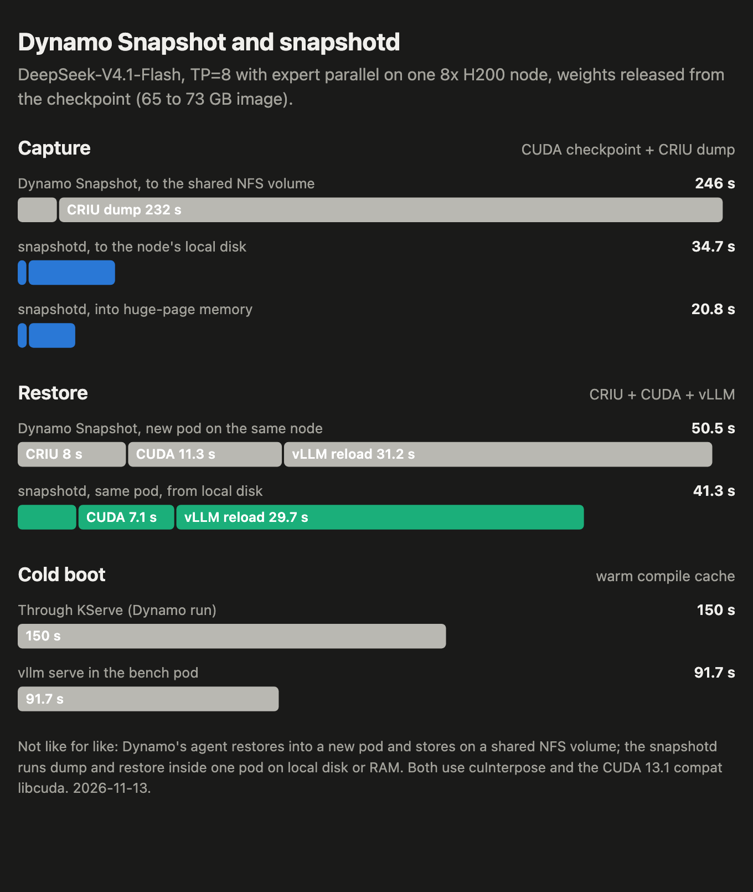

# Benchmarks

Cold boot against restore from a CRIU checkpoint for vLLM at tensor parallel 2 and 4, with the
phases broken out, and [`snapshotd`](daemon) against Dynamo Snapshot's CUDA path on the same workload.
The method and the scripts are in [`experiments/bench`](experiments/bench); the reasoning behind
the configurations is in [DESIGN.md](DESIGN.md).

## Setup

- One 8x H200 node, host driver 580.126.09 (CUDA 13.0), 2026-11-09 to 2026-11-11.
- Qwen3-8B, bf16, `--max-model-len 4096`, CUDA graphs on, weights released at
  `/checkpoint/prepare` (`--checkpoint-release-weights`) and reloaded from a network volume at
  `/checkpoint/restore`.
- vLLM nightly `a2bcb565` with [`patches/vllm`](patches/vllm). CRIU 4.2.1 and cuInterpose from
  Dynamo Snapshot `bc9d216`.
- Everything runs in one privileged pod: the server is dumped, then restored into a new network
  namespace onto the next GPU over (rank i onto rank i+1's GPU). This is the node path only. A
  restore into another pod adds the mount, cgroup and device work of a node agent, which these
  numbers do not include.
- A run passes when the restored server returns the same greedy completion as before the dump.
  Every row below passed. Rows are the mean of two runs unless noted.

## `snapshotd` against Dynamo's CUDA path

Two vLLM configurations, each checkpointed with both tools:

- **cuInterpose**: vLLM as shipped (custom all-reduce, NCCL over cuMem), preloaded with
  cuInterpose, running on the CUDA 13.1 compat `libcuda`. This is what Dynamo Snapshot needs at
  TP>1; on the host's 580 `libcuda` the restore fails.
- **No cuInterpose**: `patches/vllm/0003`, custom all-reduce and FlashInfer all-reduce off,
  `NCCL_CUMEM_ENABLE=0`. Nothing is shared between the workers at checkpoint time, so the host
  driver restores them unaided.

The tools: Dynamo's `cuda-checkpoint-helper`, one process for each PID and action in its agent's
order, or `snapshotd`, which calls the driver API for every PID in parallel.

| TP | Configuration | CUDA tool | CUDA checkpoint | CRIU dump | Image | CRIU restore | CUDA restore | vLLM restore | Restore total | Cold boot |
| --- | --- | --- | --- | --- | --- | --- | --- | --- | --- | --- |
| 2 | cuInterpose | Dynamo helper | 2.0 s | 8.4 s | 11.0 GB | 2.1 s | 2.2 s | 2.8 s | 7.4 s | 46.3 s |
| 2 | cuInterpose | `snapshotd` | 1.5 s | 8.1 s | 11.0 GB | 2.2 s | 1.9 s | 2.8 s | 7.1 s | 46.3 s |
| 2 | no cuInterpose | Dynamo helper | 2.4 s | 8.0 s | 11.7 GB | 2.3 s | 2.7 s | 9.6 s | 14.6 s | 45.3 s |
| 2 | no cuInterpose | `snapshotd` | 1.6 s | 8.1 s | 11.7 GB | 2.2 s | 1.9 s | 9.5 s | 13.6 s | 45.3 s |
| 4 | cuInterpose | Dynamo helper | 4.1 s | 14.3 s | 20.5 GB | 2.4 s | 4.4 s | 1.6 s | 8.8 s | 49.3 s |
| 4 | cuInterpose | `snapshotd` | 1.9 s | 13.7 s | 20.4 GB | 2.4 s | 3.7 s | 1.5 s | 8.0 s | 48.8 s |
| 4 | no cuInterpose | Dynamo helper | 5.2 s | 12.6 s | 22.2 GB | 2.4 s | 4.6 s | 9.6 s | 16.6 s | 46.3 s |
| 4 | no cuInterpose | `snapshotd` | 2.1 s | 12.7 s | 22.1 GB | 2.4 s | 3.5 s | 9.2 s | 15.1 s | 46.3 s |

Restore total runs from the start of `criu restore` to the end of `/checkpoint/restore`, and
includes the cuInterpose coordinator's restore phase (0.2 to 0.4 s) where it runs. Cold boot runs
from `vllm serve` to a healthy server with warm compile caches; the first boot in a fresh pod took
60 to 103 s and is left out.

- The CUDA checkpoint is where the tools differ: the helper's time grows with the process count
  (2.0 s to 4.1 s to 5.2 s), `snapshotd` stays near 2 s. The CUDA restore is 0.3 to 1.1 s faster
  with `snapshotd`.
- The configuration matters more than the tool. Without cuInterpose the workers destroy NCCL and
  release their CUDA graphs at prepare, and recapturing the graphs is about 7 s of the vLLM
  restore. cuInterpose keeps both across the checkpoint, at the price of the preload and the 13.1
  `libcuda`.
- Restore is 3 to 6 times faster than a cold boot in every row.

## CPU KV offload

`--kv-offloading-size N` keeps an N GiB region in `/dev/shm`. Kept in the checkpoint, CRIU copies
it into the image, which is what vLLM does without `patches/vllm/0005`. With it, vLLM frees the
region at prepare and refills it at restore. TP=2, no cuInterpose, `snapshotd`, one run each.

| Offload | Region | Prepare | CRIU dump | Image | Restore total | Cold boot |
| --- | --- | --- | --- | --- | --- | --- |
| none | | 0.6 s | 8.6 s | 11.3 GB | 14.7 s | 43.3 s |
| 16 GiB | kept | 0.6 s | 19.9 s | 27.3 GB | 23.4 s | 48.3 s |
| 16 GiB | released | 2.1 s | 8.6 s | 11.4 GB | 16.9 s | 48.3 s |
| 128 GiB | kept | 0.6 s | 84.1 s | 139.4 GB | 82.8 s | 75.5 s |
| 128 GiB | released | 12.3 s | 8.5 s | 11.4 GB | 43.3 s | 74.5 s |

A kept 128 GiB region makes the restore slower than a cold boot. Released, the refill is 26 to
29 s of the 43.3 s. After every restore the server loaded blocks back from the CPU region, so the host
registrations survive the move to other GPUs in both modes.

Keeping the region needs CRIU's ghost-file limit above the size of one region file (up to 4 GiB).
Dynamo Snapshot's agent passes that limit as a 32-bit field defaulting to 512 MB, so it cannot
keep a region whose files reach 4 GiB, which a 128 GiB region's do. This follows from its source;
it was not run.

## Dynamo Snapshot and `snapshotd` on a large model

DeepSeek-V4.1-Flash, TP=8 with expert parallel on one 8x H200 node, cuInterpose and the CUDA 13.1
compat `libcuda`, weights released from the checkpoint. 2026-11-13.

| | Dynamo Snapshot | `snapshotd`, local disk | `snapshotd`, huge-page memory |
| --- | --- | --- | --- |
| Checkpoint size | 73 GB | 65.1 GB | 69.9 GB |
| CUDA checkpoint | 14.4 s | 3.8 s | 3.9 s |
| CRIU dump | 3m52s, to a shared NFS volume | 30.9 s | 16.9 s |
| CRIU restore | 8.0 s | 4.4 s | 9.8 s |
| CUDA restore | 11.3 s | 7.1 s | 7.0 s |
| vLLM restore, with the weight reload | 31.2 s | 28.9 s | 29.6 s |
| Cold boot | 150 s through KServe | 91.7 s | 90.7 s |

Not like for like. Dynamo's agent restores into a new pod, as a DaemonSet, and its only storage
backend is a volume claim, here NFS at about 315 MB/s. The `snapshotd` columns dump and restore
inside one pod. Most of the capture gap is the storage; the CUDA checkpoint gap is the tool
(one helper process for each PID in sequence against driver calls in parallel). Two nodes with
`snapshotd` are in [experiments/p2p-transfer.md](experiments/p2p-transfer.md); the same model has
not been run through Dynamo's agent across nodes on this stack.

## Not measured yet

- Dynamo Snapshot's agent as a DaemonSet, restoring into another pod. A first TP=2 run captured in
  54.8 s (CRIU dump 52.2 s, CUDA checkpoint 2.1 s) and failed the restore in cuInterpose's
  `RestoreUnicast`; the image had only the CUDA 13.0 compat `libcuda`.
- TP=8 with expert parallel (DeepSeek-V4.1-Flash, GLM-5.3), which needs a whole node.
