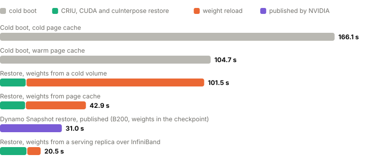
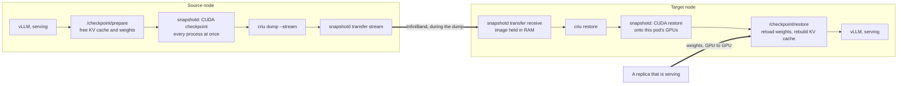
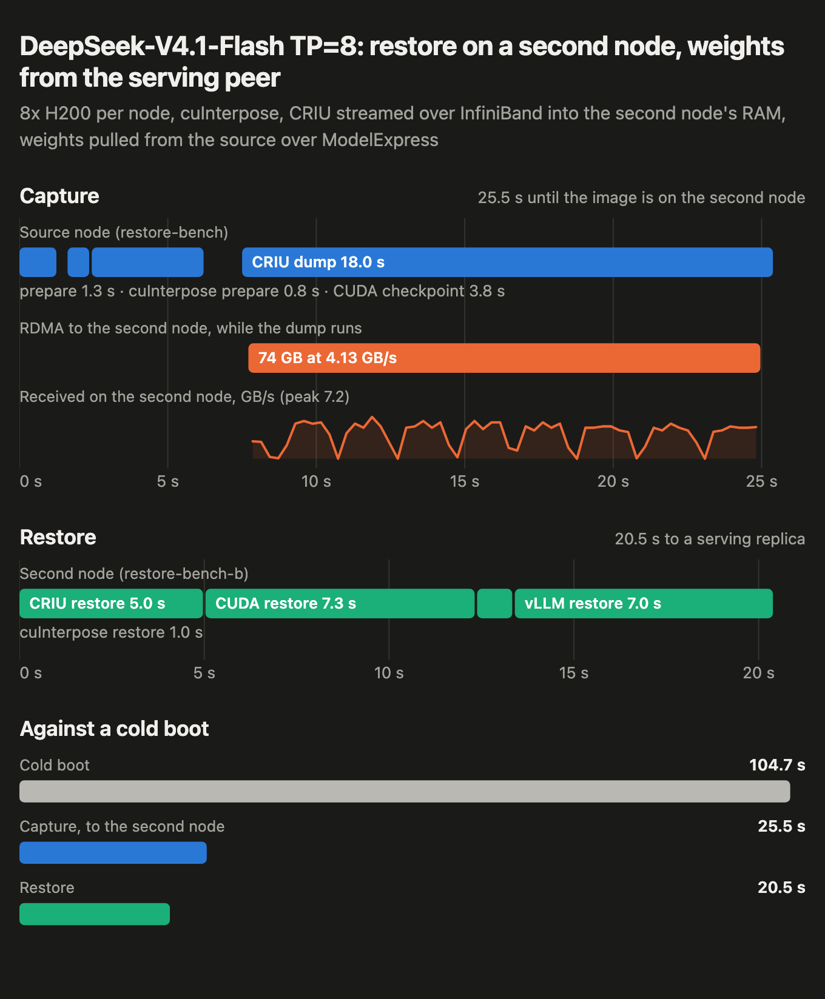

# kserve-snapshot-poc

Scale out KServe `LLMInferenceService` replicas by restoring vLLM from a CRIU checkpoint instead
of cold-booting it. The weights are left out of the checkpoint and pulled on restore from a
replica that is already serving, over InfiniBand through
[ModelExpress](https://github.com/ai-dynamo/modelexpress). The checkpoint itself is streamed to the
target node's RAM while it is being taken.

It starts from [NVIDIA Dynamo Snapshot](https://github.com/ai-dynamo/snapshot) and replaces its
node agent with `snapshotd`, a Rust daemon written for vLLM.

DeepSeek-V4.1-Flash, tensor and expert parallel on 8 H200s, captured on one node and restored on
another. One run of each; the published figure is NVIDIA's, on different hardware.
[How the numbers compare](docs/differences.md).

## How it works

1. **Prepare.** vLLM drains, then frees its KV cache and its weights. About 5 GB stays on each
   GPU, which the driver checkpoints in 3.8 s and restores in 7.3 s for 8 GPUs.
2. **Capture.** `snapshotd` checkpoints every CUDA process in parallel, and CRIU dumps into a
   pipe that `snapshotd` sends over RDMA as it fills. Nothing is written on the source.
3. **Restore.** The target restores from the image in its RAM, the driver puts GPU state back,
   and vLLM pulls its weights from a serving replica. With no replica serving it reads them from
   the model volume (the 101.5 s and 42.9 s rows in the chart).

A whole run, with the transfer rate and each phase, as the bench harness draws it:

## Documentation

| If you want to know | Read |
| --- | --- |
| How this differs from Dynamo Snapshot, and what each optimization is worth | [docs/differences.md](docs/differences.md) |
| Every measurement, with setup and caveats | [docs/benchmarks.md](docs/benchmarks.md) |
| How capture on one node and restore on another works, and what went wrong on the way | [docs/cross-node.md](docs/cross-node.md) |
| How the image is held in huge-page memory | [docs/memory-capture.md](docs/memory-capture.md) |
| Why a Rust daemon, its privilege model, and the experiments behind it | [docs/design.md](docs/design.md) |
| What KServe has to lifecycle, with diagrams, and where another engine plugs in | [docs/architecture.md](docs/architecture.md) |
| The node daemon: a pod-level diagram, how to run it on kind, and what a control plane still has to add | [docs/orchestration.md](docs/orchestration.md) |
| The daemon as the node agent of llm-d-rl-time-slicing: two RL jobs taking turns on a GPU | [docs/orchestration.md](docs/orchestration.md#time-slicing) |
| How to deploy either path, and the RDMA transfer settings | [deploy/README.md](deploy/README.md) |
| What `snapshotd` does today and how to build it | [daemon/README.md](daemon/README.md) |
| What each upstream patch changes | [patches/README.md](patches/README.md) |
| How to rerun an experiment | [experiments/README.md](experiments/README.md) |

## Results at a glance

| Workload | Cold boot | Restore | Details |
| --- | --- | --- | --- |
| DeepSeek-V4.1-Flash, TP=8 with expert parallel, two nodes, weights from a serving replica | 104.7 s | 20.5 s | [cross-node](docs/cross-node.md#weights-from-the-serving-peer) |
| The same, weights from the model volume | 166.1 s | 42.9 to 101.5 s | [cross-node](docs/cross-node.md#deepseek-v41-flash-tp8-two-whole-nodes) |
| gpt-oss-120b, TP=4, two nodes, 106 GB checkpoint | 72.5 s | 17.2 to 18.6 s | [cross-node](docs/cross-node.md#results) |
| Qwen3-8B, TP=4, one node, onto other GPUs | 48.8 s | 8.0 s | [benchmarks](docs/benchmarks.md#snapshotd-against-dynamos-cuda-path) |
| Qwen3-8B, TP=1, through KServe, pod creation to Ready | 89 s | 37 to 41 s | [benchmarks](docs/benchmarks.md#end-to-end-through-kserve) |

Capture, from the start of the checkpoint to a complete image on the second node: 25.5 s for
DeepSeek (74 GB), 33.0 s for gpt-oss-120b (106 GB).

## Repository layout

| Path | What it is |
| --- | --- |
| [`daemon/`](daemon) | `snapshotd`: CUDA checkpoint and restore through the driver API with GPU remap, the cuInterpose integration, image streaming and the RDMA transfer. |
| [`patches/`](patches) | Changes to vLLM, ModelExpress and Dynamo Snapshot as patch files against pinned commits ([`upstream.tsv`](upstream.tsv)). `./checkout.sh vllm` applies a project's patches to a clean clone in `src/`. |
| [`experiments/`](experiments) | Pod specs and scripts for every measurement: `in-place/`, `criu/`, `bench/`, which holds the two-node harness and the trace renderer, `timeslice/` and `weights-file/`. |
| [`deploy/`](deploy) | Kustomize for both paths: Dynamo Snapshot through KServe, and the `snapshotd` bench pods with the RDMA image transfer and ModelExpress weights as components. |
| [`docs/`](docs) | The documents above and their images. |
| [`kserve-dynamo-snapshot/`](https://github.com/wseaton/kserve-dynamo-snapshot) | Submodule. The KServe integration on Dynamo Snapshot's agent: config layer, entrypoint, admission webhook and controller, smoke tests. |

## Status

Built and measured from a privileged bench pod: the vLLM patches, `snapshotd`'s CUDA, cuInterpose,
image and transfer parts, and restore across nodes up to TP=8. Running end to end through KServe:
the integration on Dynamo Snapshot's agent. Design only: the `snapshotd` DaemonSet that restores
into a new pod and ties these into KServe ([docs/design.md](docs/design.md)).
