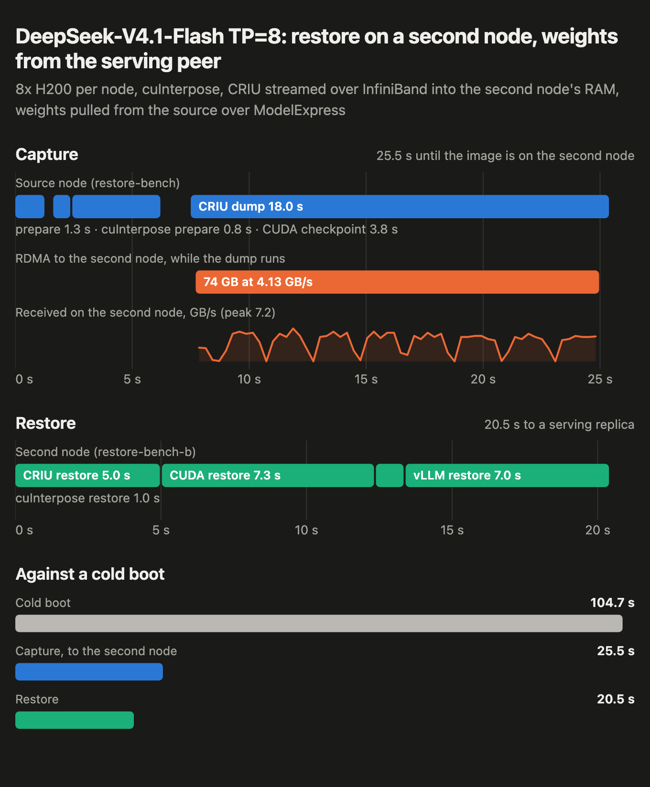
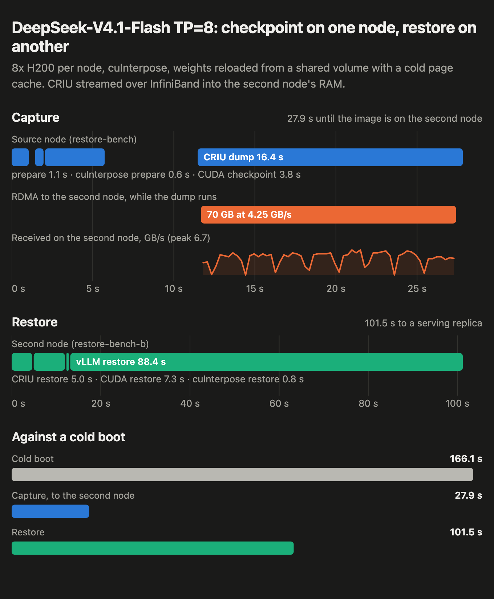
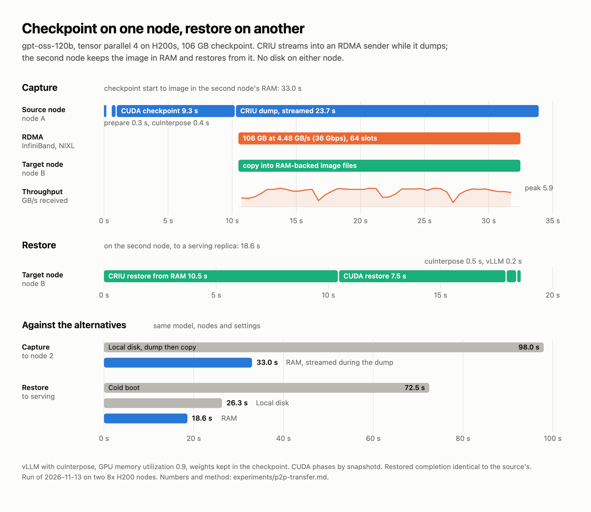
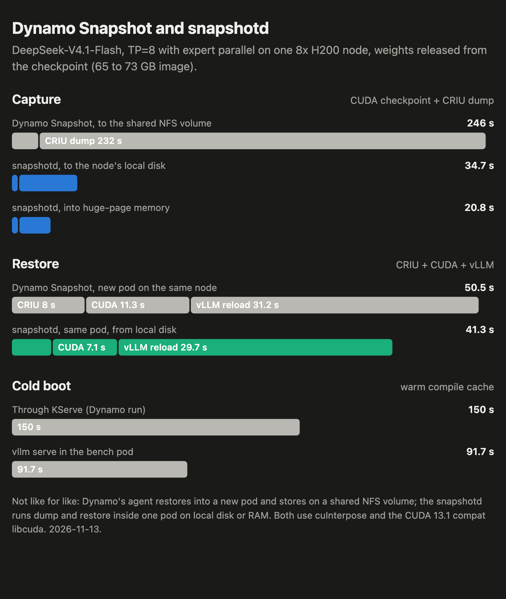

+++
title = "Benchmarks"
weight = 30
+++

## Setup

Unless noted: 8x H200 nodes on CKS, driver 580.126.09 (CUDA 13.0), ConnectX-7 InfiniBand, vLLM
nightly `a2bcb565` with [`patches/vllm`](https://github.com/wseaton/snapshotd/tree/main/patches/vllm),
CRIU 4.2.1 and cuInterpose from Dynamo Snapshot `bc9d216`. "cuInterpose" runs use the CUDA 13.1
compat `libcuda`. A run passes when the restored server returns the source's greedy completion.
Scripts: [`experiments/`](https://github.com/wseaton/snapshotd/tree/main/experiments). Bench-pod
runs dump and restore from a privileged pod, without a node agent's mount, cgroup and device work.

Restore total is `criu restore` start to `/checkpoint/restore` end. Cold boot is `vllm serve` to
healthy, with warm compile caches.

## DeepSeek-V4.1-Flash across two nodes

TP=8 + EP, two whole nodes in one InfiniBand leaf group, cuInterpose, weights released at prepare,
CRIU streamed into the target's RAM (`OVERLAP=1 IMG_DIR=/mem/...`). One run each.

### Weights from a serving peer

| Phase | Seconds |
| --- | --- |
| Cold boot on the source, weights in page cache | 104.7 |
| vLLM prepare, cuInterpose prepare, CUDA checkpoint | 1.3, 0.8, 3.8 |
| CRIU dump, 74.3 GB streamed at 4.13 GB/s (peak 7.2) | 18.0 |
| **Checkpoint start to image on the second node** | **25.5** |
| CRIU restore, CUDA restore, cuInterpose restore | 5.0, 7.3, 1.0 |
| vLLM restore: 64.15 GB to each of 8 workers at 290 Gbps, 1.8 s on the wire | 7.0 |
| **Restore** | **20.5** |

The peer is a second server cold-booted on the source after capture (`MX=1 NET=pod PEER=1`).

### Weights from the model volume

| Phase | Seconds |
| --- | --- |
| Cold boot on the source, weights not in page cache | 166.1 |
| vLLM prepare, cuInterpose prepare, CUDA checkpoint | 1.1, 0.6, 3.8 |
| CRIU dump, 69.9 GB streamed at 4.25 GB/s (peak 6.7) | 16.4 |
| **Checkpoint start to image on the second node** | **27.9** |
| CRIU restore, CUDA restore, cuInterpose restore | 5.0, 7.3, 0.8 |
| vLLM restore, weights not in page cache | 88.4 |
| **Restore, cold page cache** | **101.5** |
| vLLM restore, weights in page cache | 30.1 |
| **Restore, warm page cache** | **42.9** |

vLLM's prefetch of the weights is 80.6 s cold, 17.0 s warm. Everything from the image is 13 s.
The exact-match check does not work for this model: an uncheckpointed server gives different
completions to the same prompt on consecutive requests.

## gpt-oss-120b across two nodes

TP=4 on 4 of 8 GPUs per node. Weights kept in the checkpoint (release fails for this model, see
[Open](@/open.md)).

### With cuInterpose

`--gpu-memory-utilization 0.9`, 106 GB image.

| | Disk: dump, then copy | RAM: overlapped, run 1 | RAM: overlapped, run 2 |
| --- | --- | --- | --- |
| CUDA checkpoint | 9.7 s | 9.4 s | 9.3 s |
| CRIU dump | 56.5 s | 24.4 s | 23.7 s |
| Copy | 31.8 s, 3.49 GB/s | during dump, 4.35 GB/s | during dump, 4.48 GB/s |
| **Checkpoint to image on second node** | **98.0 s** | **33.8 s** | **33.0 s** |
| CRIU restore | 18.5 s | 10.2 s | 10.5 s |
| CUDA restore | 6.9 s | 6.3 s | 7.5 s |
| cuInterpose restore | 0.7 s | 0.4 s | 0.5 s |
| vLLM restore | 0.2 s | 0.2 s | 0.2 s |
| **Restore total** | **26.3 s** | **17.2 s** | **18.6 s** |
| Cold boot | 72.5 s | 72.4 s | 72.5 s |

### Patched vLLM, no cuInterpose

`--gpu-memory-utilization 0.8`, 108 GB image.

| | Disk: dump, then copy | Disk: overlapped | RAM: overlapped |
| --- | --- | --- | --- |
| CUDA checkpoint | 10.6 s | 10.7 s | 9.5 s |
| CRIU dump | 54.7 s | 34.7 s | 23.9 s |
| Copy | 32.8 s, 3.48 GB/s | during dump, 3.11 GB/s | during dump, 4.52 GB/s |
| **Checkpoint to image on second node** | **98.1 s** | **47.6 s** | **33.4 s** |
| CRIU restore | 23.1 s | 16.8 s | 10.3 s |
| CUDA restore | 7.5 s | 9.6 s | 10.5 s |
| vLLM restore | 26.6 s | 25.7 s | 24.9 s |
| **Restore total** | **57.3 s** | **52.1 s** | **45.8 s** |
| Cold boot | 72.4 s | 72.4 s | 72.5 s |

vLLM restore here is ~25 s of CUDA graph recapture; cuInterpose keeps the graphs.

## Where the weights come from

Qwen3-8B (16 GB weights), TP=4, cuInterpose, streamed into the target's RAM, restored into the
pod network. Cold boot 47 to 54 s.

| Weights | Image | CUDA ckpt | Dump and copy | CRIU restore | CUDA restore | vLLM restore | Restore total |
| --- | --- | --- | --- | --- | --- | --- | --- |
| In the checkpoint | 41.1 GB | 3.6 s | 9.5 s | 4.4 s | 3.9 s | 0.2 s | 8.9 s |
| Released, model volume | 21.9 GB | 1.9 s | 5.7 s | 2.3 s | 3.2 s | 1.5 s | 7.4 s |
| Released, ModelExpress from the volume | 23.9 GB | 1.9 s | 9.4 s, not overlapped | 2.8 s | 3.1 s | 5.1 s | 11.5 s |
| Released, ModelExpress from a serving peer | 23.9 GB | 1.9 s | 5.9 s | 2.8 s | 3.2 s | 1.9 s | 8.4 s |

Peer row: 4.11 GB per worker in 0.12 s (277 Gbps). At 16 GB the three sources are within 2 s;
the gap grows with model size.

Weights in files beside the checkpoint, through vLLM's sleep-mode allocator
([`experiments/weights-file`](https://github.com/wseaton/snapshotd/tree/main/experiments/weights-file)).
Qwen3-8B, TP=1:

| Weights at restore | Weights back on GPU | Restore total | CRIU image |
| --- | --- | --- | --- |
| Released, reloaded by vLLM | 2.80 s | 5.57 s | 4.6 GB |
| Kept on the GPU, in the image | in the image | 10.3 s | 20.5 GB |
| In files, pinned buffer, 8 threads | 1.21 s | 3.83 s | 4.6 GB |

## `snapshotd` against Dynamo's CUDA path

Qwen3-8B, one node, each rank restored onto the next rank's GPU. Mean of two runs. "No
cuInterpose" is `patches/vllm/0003` with custom and FlashInfer all-reduce off and
`NCCL_CUMEM_ENABLE=0`. The Dynamo helper runs one process per PID and action;
`snapshotd` calls the driver for every PID in parallel.

| TP | Configuration | CUDA tool | CUDA ckpt | CRIU dump | Image | CRIU restore | CUDA restore | vLLM restore | Restore total | Cold boot |
| --- | --- | --- | --- | --- | --- | --- | --- | --- | --- | --- |
| 2 | cuInterpose | Dynamo helper | 2.0 s | 8.4 s | 11.0 GB | 2.1 s | 2.2 s | 2.8 s | 7.4 s | 46.3 s |
| 2 | cuInterpose | `snapshotd` | 1.5 s | 8.1 s | 11.0 GB | 2.2 s | 1.9 s | 2.8 s | 7.1 s | 46.3 s |
| 2 | no cuInterpose | Dynamo helper | 2.4 s | 8.0 s | 11.7 GB | 2.3 s | 2.7 s | 9.6 s | 14.6 s | 45.3 s |
| 2 | no cuInterpose | `snapshotd` | 1.6 s | 8.1 s | 11.7 GB | 2.2 s | 1.9 s | 9.5 s | 13.6 s | 45.3 s |
| 4 | cuInterpose | Dynamo helper | 4.1 s | 14.3 s | 20.5 GB | 2.4 s | 4.4 s | 1.6 s | 8.8 s | 49.3 s |
| 4 | cuInterpose | `snapshotd` | 1.9 s | 13.7 s | 20.4 GB | 2.4 s | 3.7 s | 1.5 s | 8.0 s | 48.8 s |
| 4 | no cuInterpose | Dynamo helper | 5.2 s | 12.6 s | 22.2 GB | 2.4 s | 4.6 s | 9.6 s | 16.6 s | 46.3 s |
| 4 | no cuInterpose | `snapshotd` | 2.1 s | 12.7 s | 22.1 GB | 2.4 s | 3.5 s | 9.2 s | 15.1 s | 46.3 s |

The no-cuInterpose path pays ~7 s of CUDA graph recapture in the vLLM restore.

## DeepSeek on one node against Dynamo Snapshot

TP=8 + EP, cuInterpose, weights released.

| | Dynamo Snapshot | `snapshotd`, local disk | `snapshotd`, huge-page memory |
| --- | --- | --- | --- |
| Checkpoint size | 73 GB | 65.1 GB | 69.9 GB |
| CUDA checkpoint | 14.4 s | 3.8 s | 3.9 s |
| CRIU dump | 3m52s, to NFS | 30.9 s | 16.9 s |
| CRIU restore | 8.0 s | 4.4 s | 9.8 s |
| CUDA restore | 11.3 s | 7.1 s | 7.0 s |
| vLLM restore, with weight reload | 31.2 s | 28.9 s | 29.6 s |
| Cold boot | 150 s through KServe | 91.7 s | 90.7 s |

Dynamo's agent restores into a new pod and writes to NFS at ~315 MB/s; the `snapshotd` columns
stay in one pod.

## CPU KV offload

`--kv-offloading-size N` keeps an N GiB region in `/dev/shm`. "Released" is `patches/vllm/0005`.
TP=2, no cuInterpose, one run each.

| Offload | Region | Prepare | CRIU dump | Image | Restore total | Cold boot |
| --- | --- | --- | --- | --- | --- | --- |
| none | | 0.6 s | 8.6 s | 11.3 GB | 14.7 s | 43.3 s |
| 16 GiB | kept | 0.6 s | 19.9 s | 27.3 GB | 23.4 s | 48.3 s |
| 16 GiB | released | 2.1 s | 8.6 s | 11.4 GB | 16.9 s | 48.3 s |
| 128 GiB | kept | 0.6 s | 84.1 s | 139.4 GB | 82.8 s | 75.5 s |
| 128 GiB | released | 12.3 s | 8.5 s | 11.4 GB | 43.3 s | 74.5 s |

Kept needs CRIU's ghost limit above the region file size (up to 4 GiB). Dynamo's agent passes it
as a 32-bit field, so it cannot keep a 128 GiB region (from its source, not run).

## Capture into huge-page memory

`snapshotd image hold` as the other end of `criu dump --stream`. One node, cuInterpose.

| Qwen3-8B TP=2, 11.8 GB | CRIU dump | CRIU restore |
| --- | --- | --- |
| Local disk | 5.7 s | 2.2 s |
| Memory, 1 MiB pipes | 30.1 s | 5.4 s |
| Memory, 64 MiB pipes | 6.6 s | 5.5 s |

| DeepSeek TP=8, ~70 GB | CRIU dump | CRIU restore | Huge pages |
| --- | --- | --- | --- |
| Local disk | 37.0 s | 5.1 s | |
| Memory, faulted during the dump | 692.9 s | 11.3 s | 79% |
| Memory, 76 GiB faulted in first (19.4 s) | 16.9 s | 9.8 s | 100% |

## The daemon

`snapshotd node` as a DaemonSet, Qwen3-8B TP=1 unless noted, weights in the checkpoint. Times are
pod creation to Ready.

| Run | First replica | Later, same node | Later, other node | Pull |
| --- | --- | --- | --- | --- |
| Deployment, scaled by KEDA | | 9 s | 20 s, 22 s | 4.5 GiB, 5.8 s |
| KServe | 85 s | 8 s | 30 s, 30 s | 4.3 GiB, 6.7 s, shared |
| OpenShift, H100, Qwen3-0.6B | 76 s | 12 s, 14 s | | |
| Prefill/decode Deployments | 91 s, 92 s | | 32 s, 36 s | |
| Prefill/decode under KServe | 88 s, 77 s | | 20 s, 21 s | |
| Prefill/decode, both nodes pulling at once | | | 15 s | 4.5 GiB each way, 5.4 s, 5.6 s |

A first replica is cold boot (60 s) + checkpoint (~7 s) + restore (~4 s). Prefill/decode answered
260 of 260 and 280 of 280 retrieval prompts. Peer selection by topology picked the same-leaf
holder; asking both peers took 15 ms.

## Time-slicing

One H200, the project's orchestrator as shipped.

| Jobs | Handoffs | Snapshot | Restore |
| --- | --- | --- | --- |
| Two 72 GiB stand-ins on a 141 GiB GPU | 8 | 25.0 s | 10.1 s |
| Two verl GRPO jobs sharing the trainer GPU | 9 | 6.9 s | 3.9 s |

## Dynamo Snapshot through KServe

The earlier integration on Dynamo Snapshot's agent
([kserve-dynamo-snapshot](https://github.com/wseaton/kserve-dynamo-snapshot#results)). Pod creation
to Ready:

| Run | Restored | Cold boot |
| --- | --- | --- |
| TP=1, weights from a peer over InfiniBand | 37 to 41 s | 89 s |
| TP=2, another node | 62 s | 177 s |
| TP=8, another node | 97 s | 391 s |
| DeepSeek-V4.1-Flash, TP=8 + EP, same node | 60 s | 148 s |

The TP=1 first replica took 156 s (cold boot, capture, restore). Restored replicas pulled 16.4 GB
from a peer in 0.64 to 1.73 s (76 to 205 Gbps) and were token-identical to the first.
