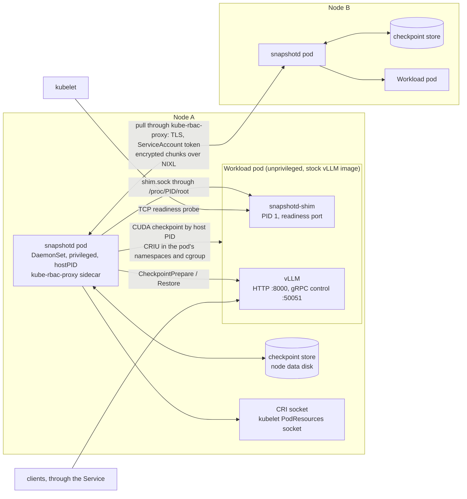
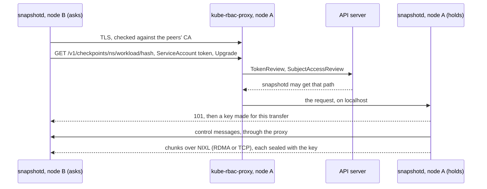

# What an orchestrator still has to add

`snapshotd node` ([daemon/](../daemon), manifests in [daemon/deploy](../daemon/deploy)) makes
restore-on-scale-up work for a plain Deployment with nothing else installed. That is on purpose:
it shows how little the engine needs from the control plane. It also means every decision a
control plane normally makes is either missing or hard-coded. This page lists them.

It has run with a hand-written Deployment, scaled by hand and by KEDA, on H200 nodes and on kind.
It has not run under an `LLMInferenceService`.

## Where things run



The workload pod's template differs from a plain vLLM Deployment in four places: the opt-in label,
an init container that copies `snapshotd-shim` and the `io_uring` launcher into an `emptyDir`, the
container command wrapped in `snapshotd-shim --`, and a TCP readiness probe on the shim's port.
The example is [daemon/deploy/workload](../daemon/deploy/workload).

## Trying it

```bash
kubectl apply -k deploy/snapshotd/node       # the DaemonSet; needs cert-manager; set its store path first
kubectl apply -k deploy/snapshotd/workload   # an example Deployment, Qwen3-8B
daemon/e2e/run.sh                            # the whole flow on kind, no GPU, a stand-in for vLLM
```

`daemon/e2e/run.sh` builds one image with `snapshotd`, a stand-in server and the distribution's
CRIU, starts a kind cluster, and checks that the first replica of a revision is checkpointed and
comes back as the same process, that later replicas are restores of it, and that a new revision
boots fresh. The stand-in ([daemon/examples/stand_in.rs](../daemon/examples/stand_in.rs)) serves
vLLM's checkpoint RPCs and an instance ID drawn at start, which is how a restore is told from a
boot. CI runs it on every change to the daemon.

## What the daemon does by itself

For every pod on its node that carries the label `snapshot.llm-d.ai/workload`:

1. It finds the pod and its container's PID through CRI and its GPUs through the kubelet's
   PodResources API.
2. If the node holds a checkpoint for `<namespace>/<workload label>/<pod-template-hash>`, it
   restores it into the pod and tells the pod's PID 1 (`snapshotd-shim`) to report ready.
3. Otherwise it lets the server cold boot, checkpoints it, restores it from that checkpoint,
   publishes the checkpoint on the node and then reports ready.
4. If a checkpoint or restore fails, the container exits, starts over, and cold boots with no
   second attempt.

The daemon does not talk to the Kubernetes API. There is no custom resource, webhook, controller
or scheduling gate.

## Checkpoints between nodes

With the `peers` component ([daemon/deploy/components/peers](../daemon/deploy/components/peers)) a
daemon whose node lacks a revision's checkpoint asks the daemons of the other nodes for it before
it lets the pod cold boot.



- Each daemon listens on localhost only. What other pods can reach is the
  [kube-rbac-proxy](https://github.com/brancz/kube-rbac-proxy) in its pod, which has the API server
  verify the caller's token and check that its ServiceAccount may `get` the path, and forwards the
  request only then. The token is a projected one: bound to the pod, valid for ten minutes, and
  accepted only for the audience `snapshotd-peers`.
- The asking daemon sends its token only after it has verified the proxy's certificate against a
  CA that cert-manager keeps for the DaemonSet.
- The chunks do not go through the proxy. They go over NIXL, which authenticates nothing, so the
  holder makes an AES-256-GCM key for each transfer, hands it over on the proxied connection, and
  both sides encrypt and decrypt each chunk in its registered buffer. A chunk's file, offset and
  length are authenticated with it.

Qwen3-8B at TP=1 on H200, one replica scaled to four by KEDA over two nodes: the new replica on
the node that held the checkpoint was Ready 9 s after its pod was created, and the two on the other
node after 20 s and 22 s. Each of those pulled the 4.5 GiB checkpoint in 5.8 s, one after the
other, and restored in 5 to 8 s. A request loop against the Service got only 200s throughout.

Who may pull is then a matter of RBAC: the `snapshotd-peers` ClusterRole, bound to the DaemonSet's
ServiceAccount. Every daemon runs as that one account, so the proxy tells a daemon of this cluster
from anything else, not one node's daemon from another's.

## A limit on tensor parallel below a whole node

A server whose workers share GPU memory (tensor parallel above 1 with vLLM's defaults, which is why
it runs under cuInterpose) can be restored only onto GPUs with the same device minors as the ones
it was checkpointed on. On other GPUs the daemon does not try: it logs why and lets the pod cold
boot.

The driver moves each restored process to its new GPU, which is why a single-GPU server restores
anywhere. What fails afterwards is the workers re-importing the memory they share:
`cuMemImportFromShareableHandle` returns `CUDA_ERROR_INVALID_DEVICE` when the new GPU was not
visible to the process at checkpoint time, and `CUDA_ERROR_NOT_INITIALIZED` when it was visible but
CUDA had not initialized it. A process can import only on a device it had initialized when it was
checkpointed. Qwen3-8B at TP=2 and TP=4 on H200, driver 580.126.09:

| The restore lands on | The container sees | Result |
| --- | --- | --- |
| the GPUs it was checkpointed on | its own | works |
| the same GPUs in another order | its own | works |
| another node, same device minors | every GPU | works |
| GPUs with other minors | its own | `CUDA_ERROR_INVALID_DEVICE` |
| GPUs with other minors | every GPU | `CUDA_ERROR_NOT_INITIALIZED` |

It is the same with cuInterpose from Dynamo Snapshot's `main` of 2026-11-18. Pairing GPUs by PCI
bus order, aliasing the old `/dev/nvidiaN` paths and widening the restore map to every visible GPU
change nothing.

Who is affected: a pod that takes a whole node always gets the same minors, so TP=8 on an 8-GPU
node restores on any node. A pod that takes some of a node's GPUs restores only where the kubelet
happens to hand it the same minors, which nothing in Kubernetes can ask for. The way out for those
is to stop sharing memory between workers ([docs/design.md](design.md): `--disable-custom-all-reduce`,
`NCCL_CUMEM_ENABLE=0`, FlashInfer all-reduce off, with `patches/vllm/0003`), which this path has not
been run with.

## What it leaves to an orchestrator

| Concern | Today | What a real solution has to decide or build |
| --- | --- | --- |
| Shaping the pod | The Deployment is written by hand: the opt-in label, an init container that brings the shim, the wrapped command, vLLM's flags and environment, a TCP readiness probe on the shim's port | Something has to apply this to pods it does not own: a KServe config layer or an admission webhook. It also has to keep the shim, the daemon and the CRIU and cuInterpose tools at matching versions, because a checkpoint taken with one set is restored with whatever the node runs then |
| Who may opt in | Anyone who can set a pod label | The label makes a privileged daemon enter the pod and run CRIU there, and a restore puts a saved process image into the pod. Opting in has to be an authorized act: admission policy on the label, or a decision made by the controller instead of by a label |
| Eligibility | None; every labelled pod is tried | Refuse what cannot be checkpointed or would be wrong to restore: multi-node workers, prefill/decode pairs, engines without the checkpoint lifecycle, runtime-loaded LoRA adapters, routing that depends on per-replica cache state. Today such a pod fails its checkpoint and cold boots, after paying for the attempt |
| Revision identity | Namespace, the label's value and `pod-template-hash` | The hash covers the pod template only. It does not cover model files that change under the same path, an image referenced by tag, or a Deployment deleted and created again with the same template. A real key adds those, and a way to invalidate |
| Node compatibility | Not checked. A checkpoint is restored on whatever node holds or pulls it | A checkpoint is good for one GPU model, driver, kernel and CPU feature set. Record them with the checkpoint, refuse a mismatch before trying, and invalidate after a driver or kernel upgrade |
| Scheduling | The scheduler knows nothing. A pod restores if it happens to land on a node with the checkpoint, or one that can pull it, and for TP above 1 on part of a node, on the same device minors | Prefer nodes that hold the checkpoint, and never choose incompatible ones. Without this the benefit depends on luck or on every node pulling |
| When and where to capture | The first pod of a revision on each node is checkpointed in place before it is ready, always | Whether to capture at all for a workload that never scales, where (in place, or a donor pod so the first replica is not delayed), and how many captures may run at once on a node |
| One capture per revision | Each node decides alone. Several pods of a new revision starting at once on one node all cold boot and capture, and the first to finish publishes | A claim per revision, cluster-wide, so one pod captures and the rest wait or cold boot by policy |
| Readiness and traffic | The shim opens a TCP port once the server serves; the pod's readiness probe points at it | Readiness owned by the platform: a readiness gate the engine sets, and KServe's own probes moved off the server's port. A stock HTTP readiness probe on the server passes during cold boot, before the checkpoint stops it |
| Connections during the dump | The daemon closes its own, and CRIU dumps without locking the network, so a connection someone else holds is carried into the image and is dead after the restore | Keep everything else off the server until the pod is ready (kubelet probes, an endpoint picker scraping metrics, a mesh sidecar), or accept that such a client sees a reset |
| Rollouts | A new template is a new revision and is captured again on every node it lands on | Surge capacity while old and new revisions overlap, what a rollback reuses, and whether a rollout of a one-replica service should capture at all, since it only makes that replica slower |
| Checkpoint storage | One directory per revision on the node's disk. Nothing is ever deleted, and the space is not charged to any pod | Retention and eviction per node, deletion when the workload goes away (the daemon cannot see that without the API), quotas per tenant, and accounting. With weights kept in the checkpoint an image is the size of the model per revision per node |
| What a checkpoint contains | Process memory, written to the node's disk unencrypted | It can hold whatever the server had in memory: credentials from its environment, request data. Decide on encryption at rest, who may read the store, and whether tenants may share nodes |
| Trust between nodes | A daemon reaches another through its kube-rbac-proxy with a ServiceAccount token, and the chunks are encrypted with a key made per transfer. Every daemon is the same ServiceAccount, and any daemon may pull any revision | An identity per node, so a compromised node cannot ask for revisions it has no pod of: the holder checking that the asking node runs that revision, or node-attested identities. NetworkPolicy around the proxy and NIXL ports |
| A bad checkpoint | A failed restore is remembered for that pod only. The next pod on the node tries the same checkpoint again | Reject a checkpoint for the whole revision after a failed restore, on every node, and report it |
| Failure of the daemon | A pod whose daemon dies mid-operation waits; a pod that starts with no daemon cold boots after 30 s | Timeouts on every step, a daemon restart that resumes or cleans up, and upgrades of the DaemonSet that do not strand pods |
| Observability | The daemon's log and one marker file | Pod conditions and events, restore and capture timings as metrics, and a way to list which nodes hold which revision |
| An API for operators | None | A resource that says a checkpoint exists, where, for which revision and in what state, so it can be listed, deleted and recaptured |
| Scale to zero | A checkpoint outlives its pods, so a pod that returns to a node that has it is restored | Whether nodes keep checkpoints for workloads at zero, and for how long |
| Autoscaler tuning | None | Scale-up now takes seconds for later replicas and a cold boot plus a capture for the first. Stabilization windows, cooldowns and readiness budgets chosen for cold boots are wrong for both |
| Weights | Kept in the checkpoint | Releasing them and reloading from a serving peer ([docs/cross-node.md](cross-node.md)) is not part of this path yet; it needs ModelExpress and its own readiness and failure handling |
| Other containers in the pod | One container, named by `--container`, is handled | Mesh sidecars and other containers that hold connections to the server or share its volumes |
| The engine's API | vLLM's gRPC control port, with the checkpoint RPCs of [patches/vllm/0006](../patches/vllm), served only by the Rust frontend | Those RPCs upstream, and a statement of which vLLM versions and frontends are supported |

## What it does not need

These exist in the Dynamo Snapshot integration ([docs/architecture.md](architecture.md)) and are
absent here: a `SnapshotJob` or `PodSnapshot`, a donor pod, pods held unscheduled while a capture
runs, a volume every node mounts, and a privileged or modified workload pod. An orchestrator can
add any of them back as policy; the engine does not depend on them.
