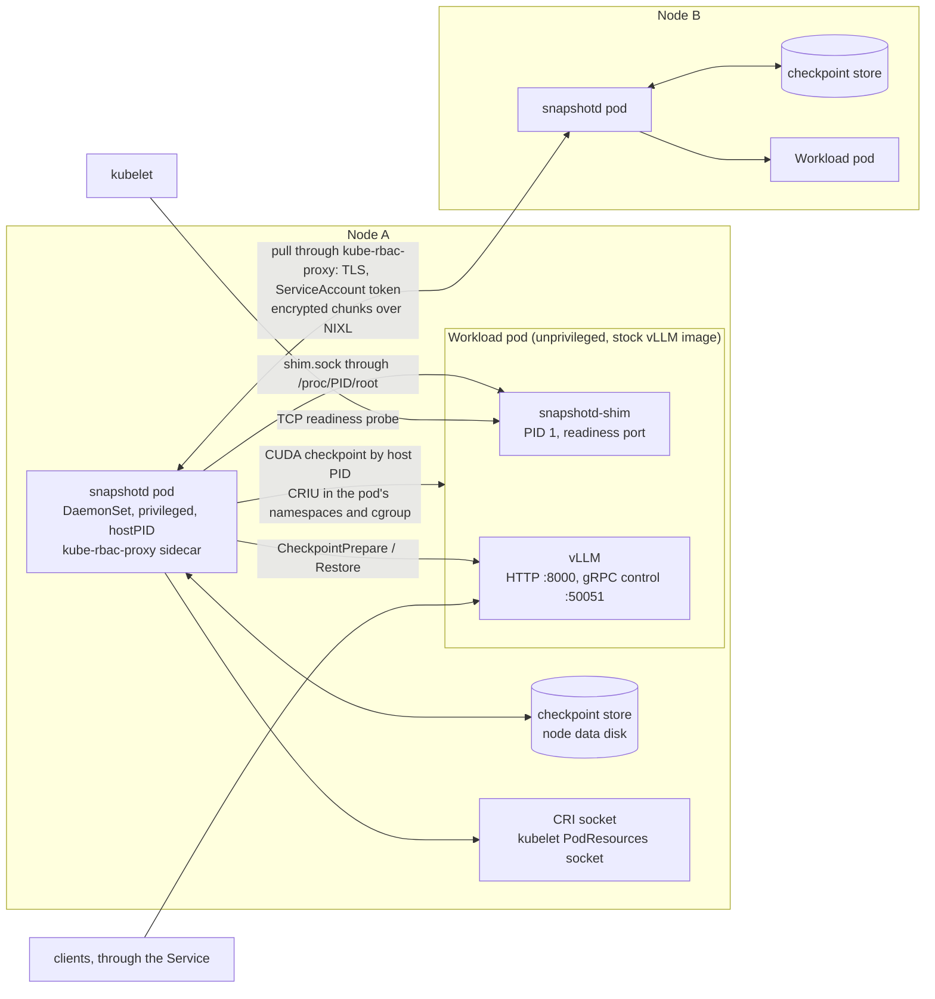
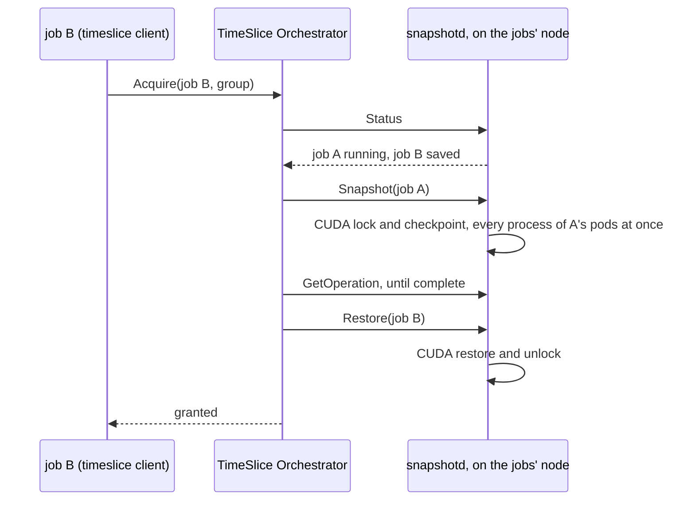

# What an orchestrator still has to add

`snapshotd node` ([daemon/](../daemon), manifests in [daemon/deploy](../daemon/deploy)) makes
restore-on-scale-up work for a plain Deployment with nothing else installed. That is on purpose:
it shows how little the engine needs from the control plane. It also means every decision a
control plane normally makes is either missing or hard-coded. This page lists them.

It has run with a hand-written Deployment, scaled by hand and by KEDA, with a KServe
`LLMInferenceService` through a config layer, on H200 nodes, and on kind with a stand-in server.

## Where things run



The workload pod's template differs from a plain vLLM Deployment in four places: the opt-in label,
an init container that copies `snapshotd-shim` and the `io_uring` launcher into an `emptyDir`, the
container command wrapped in `snapshotd-shim --`, and probes on the shim's port, which answers TCP
and HTTP. The example is [daemon/deploy/workload](../daemon/deploy/workload).

## Trying it

```bash
kubectl apply -k deploy/snapshotd/node       # the DaemonSet; needs cert-manager; set its store path first
kubectl apply -k deploy/snapshotd/node-openshift   # the same for OpenShift, see "On OpenShift"
kubectl apply -k deploy/snapshotd/workload   # an example Deployment, Qwen3-8B
kubectl apply -k deploy/snapshotd/kserve/qwen3-8b   # or the same model as an LLMInferenceService
daemon/e2e/run.sh                            # the whole flow on kind, no GPU, a stand-in for vLLM
daemon/e2e/peers.sh                          # checkpoints between nodes, on three kind workers
```

`daemon/e2e/run.sh` builds one image with `snapshotd`, a stand-in server and the distribution's
CRIU, starts a kind cluster, and checks that the first replica of a revision is checkpointed and
comes back as the same process, that later replicas are restores of it and carry their pod's
security label, and that a new revision boots fresh. The stand-in ([daemon/examples/stand_in.rs](../daemon/examples/stand_in.rs)) serves
vLLM's checkpoint RPCs and an instance ID drawn at start, which is how a restore is told from a
boot. CI runs it on every change to the daemon.

`daemon/e2e/peers.sh` does the same on three workers with the daemon built with NIXL, a
kube-rbac-proxy in front of each and node labels for two racks. It checks that a node without a
checkpoint pulls it and restores from it, that a node with holders in its own rack and in the
other pulls from its own, that the proxy answers a daemon's token and nothing else, and that two
nodes pull from each other at once, one of the servers having started prepared. CI runs it too.

## What the daemon does by itself

For every pod on its node that carries the label `snapshot.llm-d.ai/workload`:

1. It finds the pod and its container's PID through CRI and its GPUs through the kubelet's
   PodResources API.
2. If the node holds a checkpoint for `<namespace>/<workload label>/<pod-template-hash>`, it
   restores it into the pod and tells the pod's PID 1 (`snapshotd-shim`) to report ready.
3. Otherwise it lets the server cold boot, checkpoints it, restores it from that checkpoint,
   publishes the checkpoint on the node and then reports ready.
4. If a checkpoint or restore fails, the container exits, starts over, and cold boots with no
   second attempt.

The daemon does not watch or write anything in the Kubernetes API. Its one read is its own node's
labels, when it is told to choose peers by topology. There is no custom resource, webhook,
controller or scheduling gate.

## Checkpoints between nodes

With the `peers` component ([daemon/deploy/components/peers](../daemon/deploy/components/peers)) a
daemon whose node lacks a revision's checkpoint asks the daemons of the other nodes for it before
it lets the pod cold boot.


- Each daemon listens on localhost only. What other pods can reach is the
  [kube-rbac-proxy](https://github.com/brancz/kube-rbac-proxy) in its pod, which has the API server
  verify the caller's token and check that its ServiceAccount may `get` the path, and forwards the
  request only then. The token is a projected one: bound to the pod, valid for ten minutes, and
  accepted only for the audience `snapshotd-peers`.
- The asking daemon sends its token only after it has verified the proxy's certificate against a
  CA that cert-manager keeps for the DaemonSet.
- The chunks do not go through the proxy. They go over NIXL, which authenticates nothing, so the
  holder makes an AES-256-GCM key for each transfer, hands it over on the proxied connection, and
  both sides encrypt and decrypt each chunk in its registered buffer. A chunk's file, offset and
  length are authenticated with it.

A node pulls a revision once: pods of it that start together wait for the one pull and restore
from what it left. Different revisions are pulled side by side.

A daemon has a fixed number of transfer lanes, two unless `--transfer-lanes` says otherwise, and
takes part in that many transfers at once, sending or receiving. Each lane has its share of the
registered pool, made when the lane is first used and kept. A pull takes a lane before it asks, so
the daemon can always receive what it asked for, and a daemon whose lanes are all taken answers
busy. Two daemons that refuse each other do not wait on each other: each gives its lane up and
asks again, the one with the higher address after a longer pause.

With a prefill and a decode Deployment on different nodes, each scaled to two at the same moment,
each node pulled 4.5 GiB from the other while sending 4.5 GiB to it. Both pulls took 5.4 s and 5.6 s
and overlapped completely, and both new pods were Ready 15 s after they were created.

### Choosing a peer

A daemon's peers are every address behind the headless Service. Before it pulls, it asks all of
them at once what they hold: a plain `GET` on the checkpoint's path answers whether the peer has
it, how many lanes it has free, and where it is. It then tries the holders nearest first.

Where a node is, is said the way Kueue's `Topology` says it: an ordered list of node labels,
widest domain first. Two nodes are as near as the number of levels, from the widest, at which
their labels agree.

```text
--topology-levels   ib.coreweave.cloud/superpod, ib.coreweave.cloud/leafgroup, kubernetes.io/hostname
gf49e9c             0                            11                            gf49e9c
gf41fb2             0                            11                            gf41fb2     2 levels shared with gf49e9c
gf4334a             0                            391                           gf4334a     1 level shared
```

The list can be copied from a Kueue `Topology` object's `spec.levels`. The daemon reads its own
node's labels once, when it starts, which is the one thing it asks the Kubernetes API and needs
`get` on `nodes` for. Among holders equally near, one with a free lane is tried first; after that
the order only spreads askers over the peers. Without `--topology-levels` that spreading is all
there is.

On three H200 nodes, with those levels and a checkpoint held on `gf41fb2` and on `gf4334a`, a pod
on `gf49e9c` pulled it from `gf41fb2`. Asking both peers took 15 ms.

What this does not do yet:

1. **Choose the transport by distance.** `UCX_TLS` is one setting for every pair of nodes. Two
   nodes on one InfiniBand fabric should use it, and the levels already say when they are.
2. **Learn.** Keep what each peer delivered, in bytes per second, and prefer what was fast. Stop
   asking a peer that failed.
3. **Weigh load against distance.** A far peer that is idle may beat a near one that is busy;
   today nearness always wins and the puller waits.
4. **Let the control plane decide.** Something that knows where checkpoints are can name the
   source for a pod, place checkpoints ahead of a scale-out, and schedule pods onto nodes that
   have them. The daemon's own ranking is then what happens when nothing was decided.

Qwen3-8B at TP=1 on H200, one replica scaled to four by KEDA over two nodes, before the daemon
pulled once per node: the new replica on
the node that held the checkpoint was Ready 9 s after its pod was created, and the two on the other
node after 20 s and 22 s. Each of those pulled the 4.5 GiB checkpoint in 5.8 s, one after the
other, and restored in 5 to 8 s. A request loop against the Service got only 200s throughout.

Who may pull is then a matter of RBAC: the `snapshotd-peers` ClusterRole, bound to the DaemonSet's
ServiceAccount. Every daemon runs as that one account, so the proxy tells a daemon of this cluster
from anything else, not one node's daemon from another's.

## On OpenShift

[`deploy/snapshotd/node-openshift`](../deploy/snapshotd/node-openshift) is the same daemon with
four things swapped: it reads CRI-O's socket, it runs under the `nvidia` runtime class, which is
what puts the driver's libraries and devices in its container, its ServiceAccount is bound to the
`privileged` SCC, and the peers' certificate comes from the service CA instead of cert-manager.

Run on OpenShift with CRI-O, SELinux enforcing and H100s: Qwen3-0.6B at TP=1 in a pod under the
namespace's restricted SCC, three replicas on one node.

| Replica | Ready after | How |
| --- | --- | --- |
| first | 76 s | 64 s cold boot, 6.4 s checkpoint (5.5 GiB), 3.3 s restore |
| second and third | 12 s and 14 s | restore in 4.2 s and 3.1 s, each onto another GPU |

All three answered a completion, and a restored pod stopped in 6 s.

That run was the daemon alone on one node: the base manifest with the CRI-O socket and the
runtime class, under a ServiceAccount that already had the `privileged` SCC. The overlay's own SCC
binding and the peers with a service CA certificate have not been applied to a cluster.

Two things had to change for SELinux:

- CRIU hands its log to the processes it dumps, and a server in `container_t` may not append to a
  file in the node's store, which is `container_var_lib_t`. The dump failed on that. CRIU's work
  directory and log are now in the pod's own `/run/snapshotd/work`, and the daemon copies the log
  into the checkpoint afterwards.
- A restored process is a child of CRIU, which runs with the daemon's context, `spc_t`. Left
  there the server is not confined, and its pod's shim, in `container_t`, may not signal it: a pod
  took its whole grace period to stop. CRIU sets a restored process's label itself, but only when
  it finds SELinux, and it looks for selinuxfs and `/etc/selinux/config`, which a pod's mount
  namespace does not have. [`patches/criu`](../patches/criu) makes it go by its own process
  label, the snapshot-agent image builds CRIU with libselinux, and the daemon passes the pod's
  context to `criu restore`, so a restored server gets the label of the pod it is restored into.

Not run there: a checkpoint restored into a pod whose MCS categories differ from the pod it was
taken in (pods in one OpenShift namespace share theirs), and tensor parallel above 1, where a
pod's processes have to read cuInterpose from the tools the daemon mounts.

## Through KServe

[deploy/snapshotd/kserve/config-layer](../deploy/snapshotd/kserve/config-layer) is an
`LLMInferenceServiceConfig` named `snapshotd`. A service opts in with `baseRefs: [{name: snapshotd}]`
and nothing else; there is no webhook or controller.
[deploy/snapshotd/kserve](../deploy/snapshotd/kserve/README.md) documents every field it sets, how
KServe merges it, and what a service may still change. In short, the layer:

- labels the pods `snapshot.llm-d.ai/workload: <service name>`;
- adds the init container that brings the shim, and wraps KServe's `vllm serve` command in it, with
  the Rust frontend, the gRPC control port, sleep mode and released weights;
- points KServe's startup, readiness and liveness probes at the shim's port, so the kubelet never
  connects to the server and the pod is Ready when the daemon says so;
- runs the server as a non-root user, with an `emptyDir` at `/run/snapshotd` for the shim's socket,
  and keeps caches and `HOME` in `/dev/shm`, which travels with the checkpoint.

Run in a vCluster with KServe, the daemon on the host cluster: Qwen3-8B at TP=1, first replica
Ready 85 s after the service was created (60 s cold boot, 7.8 s checkpoint, 4.3 s restore). Scaled
to four through `spec.replicas`: 8 s on the node holding the checkpoint, and 30 s for each of two
on another node, which shared one 6.7 s pull of 4.3 GiB and then restored at the same time in 12 s.
A completion through the KServe gateway and the endpoint picker came back from the restored pods.

Not covered by that run: TLS between the gateway and vLLM, multi-node services (`LeaderWorkerSet`
pods carry no `pod-template-hash`; `--revision-label` names another label), KServe's prefill and
decode templates, and what the endpoint picker does with connections it holds to a pod that is
being checkpointed.

## Prefill and decode

Disaggregated serving works with the NIXL connector, with
[vllm-project/vllm#64371](https://github.com/vllm-project/vllm/pull/64371), which is open and is
carried here as [patches/vllm/0007](../patches/vllm). The examples are
[deploy/snapshotd/workload-pd](../deploy/snapshotd/workload-pd): the same Deployment twice, as a
`kv_producer` and as a `kv_consumer`, each a workload of its own to the daemon.

Two things differ from a server without a connector:

- vLLM can checkpoint a NIXL connector only if it has not started its NIXL agent, so the server
  runs with `--checkpoint-prepare-on-startup`: it comes up already prepared and serves nothing
  until it is restored. The daemon takes a server in that state as booted, checkpoints it without
  asking it to prepare, and every replica, the first included, serves only after a restore.
- A restored replica is a new peer. On restore vLLM gives it a new KV engine id and moves the
  connector's side channel to the pod's own address on the same interface, so
  `VLLM_NIXL_SIDE_CHANNEL_HOST` has to be the pod's address, not a name.

Qwen3-8B at TP=1 on H200, one prefill and one decode pod, then two of each over two nodes, the
second pair restored from checkpoints pulled from the first node:

| | |
| --- | --- |
| First replica of each role, Ready after | 91 s and 92 s (60 s boot to prepared, 5 to 7 s checkpoint, 5.7 s restore) |
| Second replica of each role, on another node | 32 s and 36 s, the two pulls one after the other |
| Prefill on any of the four pods, decode on any other | answered in all four pairings |
| A code buried in a 400 to 3000 token prompt, asked for through prefill then decode | 260 of 260 right, one at a time and 8 at a time |
| KV transfers counted by the two decode pods | 277 and 276, 12 GB each |

The requests in that table were sent the way a router does: to prefill with `do_remote_decode`,
then to decode with the `kv_transfer_params` it returned.

Under KServe, with its prefill and decode templates, llm-d's routing sidecar in the decode pod and
the endpoint picker, through the gateway
([deploy/snapshotd/kserve/qwen3-8b-pd](../deploy/snapshotd/kserve/qwen3-8b-pd)):

| | |
| --- | --- |
| First prefill and decode pod, Ready after | 88 s and 77 s |
| Scaled to two of each, the new pods on the node the other role was on | 20 s and 21 s, each node pulling from the other |
| Retrieval prompt through the gateway | 280 of 280 right, with one and with two pods of each role |

None of this has run over RDMA: the connector was on `UCX_TLS=tcp,cuda_copy`, which moves KV at
about 2.7 Gbit/s here. A 2000 token prompt took 0.72 s through prefill and decode against 0.08 s
on one server, all of it the transfer, so these runs say nothing about what disaggregation costs
or saves.

## Time-slicing

The same daemon can be the node agent of
[llm-d-rl-time-slicing](https://github.com/llm-d-incubation/llm-d-rl-time-slicing), whose
orchestrator lets several jobs take turns on a GPU. With `SNAPSHOTD_TIMESLICE_LISTEN` set
([`components/timeslice`](../daemon/deploy/components/timeslice)) it serves that project's
`SnapshotAgentService`, and the project's orchestrator and client libraries work against it
unchanged. Here a snapshot parks a job where it is: its processes stay alive with their device
memory in host memory, and nothing goes to the node's store.



| Call | What the daemon does |
| --- | --- |
| `Status` | Lists every job with a pod on the node, by the `timeslice.io/job-id` label, with its state and each GPU's memory. A job is running while one of its processes holds device memory, saved while they are checkpointed, idle otherwise. Nothing is remembered: the driver and NVML are asked each time, so a restarted daemon answers the same |
| `Snapshot`, `Restore` | Start an operation on the job's CUDA processes, found through the container runtime, and answer with its id. The `cuda` backend, which is what the orchestrator asks for; the others are refused |
| `GetOperation` | Pending, complete or failed, and how long it took |
| `grpc.health.v1.Health` | Serving, which the project's Python agent client checks before it calls |

The orchestrator dials an agent at `<node name>:9001`. Where node names do not resolve, a headless
Service of that name in the orchestrator's namespace does it;
[`experiments/timeslice/run.sh`](../experiments/timeslice/run.sh) makes one.

Run on one H200 with the project's orchestrator as shipped:

| Jobs | Result |
| --- | --- |
| Two stand-ins that each hold 72 GiB, so both cannot be on the 141 GiB GPU | 8 handoffs, every one with the job's memory intact. A snapshot took 25.0 s and a restore 10.1 s on average |
| The project's own example: two verl RL jobs (GRPO on DeepSeek-R1-Distill-Qwen-1.5B, one on math and one on code), their trainers sharing the GPU and each with a rollout engine on another node | Both trainers finished a training step, in 556 s and 874 s, through 9 handoffs with none failed. A snapshot took 6.9 s and a restore 3.9 s on average |

The example ran as shipped except for the shared GPU: the cluster has no DRA driver, so the two
trainer pods open the GPU through the container runtime's device mount instead of a shared
`ResourceClaim`. `experiments/timeslice/run.sh verl` makes that change and no other.

## A limit on tensor parallel below a whole node

A server whose workers share GPU memory (tensor parallel above 1 with vLLM's defaults, which is why
it runs under cuInterpose) can be restored only onto GPUs with the same device minors as the ones
it was checkpointed on. On other GPUs the daemon does not try: it logs why and lets the pod cold
boot.

The driver moves each restored process to its new GPU, which is why a single-GPU server restores
anywhere. What fails afterwards is the workers re-importing the memory they share:
`cuMemImportFromShareableHandle` returns `CUDA_ERROR_INVALID_DEVICE` when the new GPU was not
visible to the process at checkpoint time, and `CUDA_ERROR_NOT_INITIALIZED` when it was visible but
CUDA had not initialized it. A process can import only on a device it had initialized when it was
checkpointed. Qwen3-8B at TP=2 and TP=4 on H200, driver 580.126.09:

| The restore lands on | The container sees | Result |
| --- | --- | --- |
| the GPUs it was checkpointed on | its own | works |
| the same GPUs in another order | its own | works |
| another node, same device minors | every GPU | works |
| GPUs with other minors | its own | `CUDA_ERROR_INVALID_DEVICE` |
| GPUs with other minors | every GPU | `CUDA_ERROR_NOT_INITIALIZED` |

It is the same with cuInterpose from Dynamo Snapshot's `main` of 2026-11-18. Pairing GPUs by PCI
bus order, aliasing the old `/dev/nvidiaN` paths and widening the restore map to every visible GPU
change nothing.

Who is affected: a pod that takes a whole node always gets the same minors, so TP=8 on an 8-GPU
node restores on any node. A pod that takes some of a node's GPUs restores only where the kubelet
happens to hand it the same minors, which nothing in Kubernetes can ask for. The way out for those
is to stop sharing memory between workers ([docs/design.md](design.md): `--disable-custom-all-reduce`,
`NCCL_CUMEM_ENABLE=0`, FlashInfer all-reduce off, with `patches/vllm/0003`), which this path has not
been run with.

## What it leaves to an orchestrator

| Concern | Today | What a real solution has to decide or build |
| --- | --- | --- |
| Shaping the pod | A KServe config layer for `LLMInferenceService`, or a Deployment written by hand: the opt-in label, an init container that brings the shim, the wrapped command, vLLM's flags and environment, probes on the shim's port | The same for workloads that are neither, which means an admission webhook. Something also has to keep the shim, the daemon and the CRIU and cuInterpose tools at matching versions, because a checkpoint taken with one set is restored with whatever the node runs then |
| Who may opt in | Anyone who can set a pod label | The label makes a privileged daemon enter the pod and run CRIU there, and a restore puts a saved process image into the pod. Opting in has to be an authorized act: admission policy on the label, or a decision made by the controller instead of by a label |
| Eligibility | None; every labelled pod is tried | Refuse what cannot be checkpointed or would be wrong to restore: multi-node workers, engines without the checkpoint lifecycle, runtime-loaded LoRA adapters, routing that depends on per-replica cache state. Today such a pod fails its checkpoint and cold boots, after paying for the attempt |
| Revision identity | Namespace, the label's value and `pod-template-hash` | The hash covers the pod template only. It does not cover model files that change under the same path, an image referenced by tag, or a Deployment deleted and created again with the same template. A real key adds those, and a way to invalidate |
| Node compatibility | Not checked. A checkpoint is restored on whatever node holds or pulls it | A checkpoint is good for one GPU model, driver, kernel and CPU feature set. Record them with the checkpoint, refuse a mismatch before trying, and invalidate after a driver or kernel upgrade |
| Scheduling | The scheduler knows nothing. A pod restores if it happens to land on a node with the checkpoint, or one that can pull it, and for TP above 1 on part of a node, on the same device minors | Prefer nodes that hold the checkpoint, and never choose incompatible ones. Without this the benefit depends on luck or on every node pulling |
| When and where to capture | The first pod of a revision on each node is checkpointed in place before it is ready, always | Whether to capture at all for a workload that never scales, where (in place, or a donor pod so the first replica is not delayed), and how many captures may run at once on a node |
| One capture per revision | Each node decides alone. Several pods of a new revision starting at once on one node all cold boot and capture, and the first to finish publishes | A claim per revision, cluster-wide, so one pod captures and the rest wait or cold boot by policy |
| Readiness and traffic | The shim opens a port once the server serves, and every probe of the pod points at it | Readiness owned by the platform: a readiness gate the engine sets. A probe left on the server's own port passes during cold boot, before the checkpoint stops the server |
| Connections during the dump | The daemon closes its own, and CRIU dumps without locking the network, so a connection someone else holds is carried into the image and is dead after the restore | Keep everything else off the server until the pod is ready (kubelet probes, an endpoint picker scraping metrics, a mesh sidecar), or accept that such a client sees a reset |
| Rollouts | A new template is a new revision and is captured again on every node it lands on | Surge capacity while old and new revisions overlap, what a rollback reuses, and whether a rollout of a one-replica service should capture at all, since it only makes that replica slower |
| Checkpoint storage | One directory per revision on the node's disk. Nothing is ever deleted, and the space is not charged to any pod | Retention and eviction per node, deletion when the workload goes away (the daemon cannot see that without the API), quotas per tenant, and accounting. With weights kept in the checkpoint an image is the size of the model per revision per node |
| What a checkpoint contains | Process memory, written to the node's disk unencrypted | It can hold whatever the server had in memory: credentials from its environment, request data. Decide on encryption at rest, who may read the store, and whether tenants may share nodes |
| Trust between nodes | A daemon reaches another through its kube-rbac-proxy with a ServiceAccount token, and the chunks are encrypted with a key made per transfer. Every daemon is the same ServiceAccount, and any daemon may pull any revision | An identity per node, so a compromised node cannot ask for revisions it has no pod of: the holder checking that the asking node runs that revision, or node-attested identities. NetworkPolicy around the proxy and NIXL ports |
| A bad checkpoint | A failed restore is remembered for that pod only. The next pod on the node tries the same checkpoint again | Reject a checkpoint for the whole revision after a failed restore, on every node, and report it |
| Failure of the daemon | A pod whose daemon dies mid-operation waits; a pod that starts with no daemon cold boots after 30 s | Timeouts on every step, a daemon restart that resumes or cleans up, and upgrades of the DaemonSet that do not strand pods |
| Observability | The daemon's log and one marker file | Pod conditions and events, restore and capture timings as metrics, and a way to list which nodes hold which revision |
| An API for operators | None | A resource that says a checkpoint exists, where, for which revision and in what state, so it can be listed, deleted and recaptured |
| Scale to zero | A checkpoint outlives its pods, so a pod that returns to a node that has it is restored | Whether nodes keep checkpoints for workloads at zero, and for how long |
| Autoscaler tuning | None | Scale-up now takes seconds for later replicas and a cold boot plus a capture for the first. Stabilization windows, cooldowns and readiness budgets chosen for cold boots are wrong for both |
| Weights | Kept in the checkpoint | Releasing them and reloading from a serving peer ([docs/cross-node.md](cross-node.md)) is not part of this path yet; it needs ModelExpress and its own readiness and failure handling |
| Other containers in the pod | One container, named by `--container`, is handled | Mesh sidecars and other containers that hold connections to the server or share its volumes |
| The engine's API | vLLM's gRPC control port, with the checkpoint RPCs of [patches/vllm/0006](../patches/vllm), served only by the Rust frontend | Those RPCs upstream, and a statement of which vLLM versions and frontends are supported |

## What it does not need

These exist in the Dynamo Snapshot integration ([docs/architecture.md](architecture.md)) and are
absent here: a `SnapshotJob` or `PodSnapshot`, a donor pod, pods held unscheduled while a capture
runs, a volume every node mounts, and a privileged or modified workload pod. An orchestrator can
add any of them back as policy; the engine does not depend on them.
