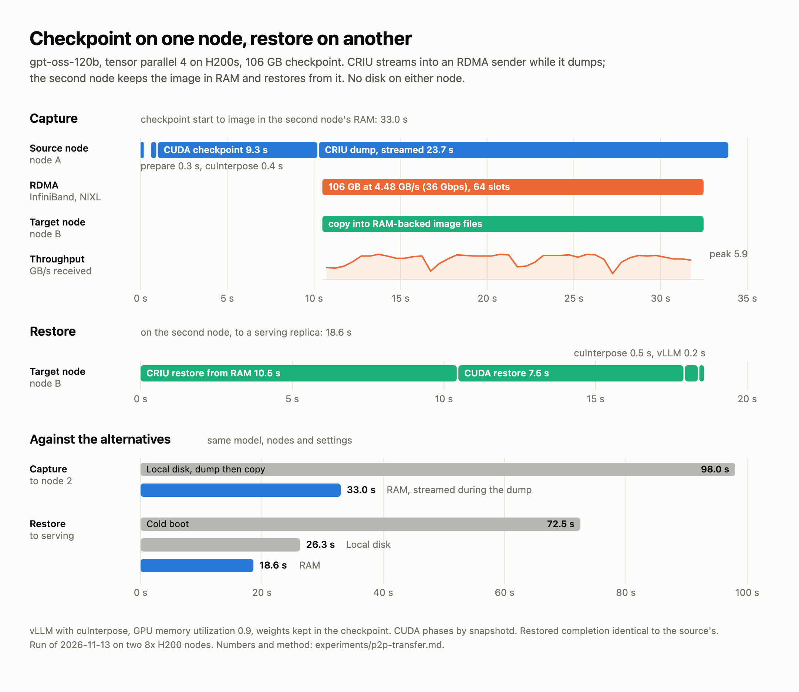

# Capture on one node, restore on another: notes

2026-11-13. The checkpoint is taken on one node's local disk or streamed straight off CRIU, copied
to a second node over InfiniBand with NIXL, and restored there. Code:
[`daemon/src/transfer.rs`](../daemon/src/transfer.rs) (`snapshotd transfer send|stream|receive`,
behind the `nixl` feature), driven by [`bench/lifecycle.sh`](bench/lifecycle.sh).

## How the copy works

Each side maps one anonymous 2 MiB-aligned region with `MADV_HUGEPAGE`, registers it with NIXL
once (through `SystemStorage::from_buffer`, ai-dynamo/nixl#2672) and cuts it into slots. A slot
carries one chunk: filled on the sender, written into the receiver's slot of the same index over
RDMA, written to the receiver's disk with `O_DIRECT`, then acknowledged and reused. Registration
takes about 0.1 s for a 4 GiB pool at 100% huge pages.

- `transfer send` reads files from the source's disk.
- `transfer stream` is the other end of `criu dump --stream`: CRIU's pipes fill the slots, so the
  copy runs while the dump does and the source writes nothing. A slow receiver backs up into
  CRIU's pipes.

## Results

All runs: 4 of 8 H200s on each of two nodes, vLLM patches 0001 to 0005, no cuInterpose,
`snapshotd` for the CUDA phases, restored server's greedy completion identical to the source's.

### Stock vLLM with cuInterpose

gpt-oss-120b, TP=4, `--gpu-memory-utilization 0.9`, cuInterpose preloaded and the CUDA 13.1 compat
`libcuda`, weights kept in the checkpoint (see Open), 106 GB image:

| | Disk: dump, then copy | RAM: overlapped, run 1 | RAM: overlapped, run 2 |
| --- | --- | --- | --- |
| CUDA checkpoint | 9.7 s | 9.4 s | 9.3 s |
| CRIU dump | 56.5 s | 24.4 s, streamed | 23.7 s, streamed |
| Copy to the second node | 31.8 s, 3.49 GB/s | inside the dump, 4.35 GB/s | inside the dump, 4.48 GB/s |
| **Checkpoint start to image on the second node** | **98.0 s** | **33.8 s** | **33.0 s** |
| CRIU restore | 18.5 s | 10.2 s | 10.5 s |
| CUDA restore | 6.9 s | 6.3 s | 7.5 s |
| cuInterpose restore | 0.7 s | 0.4 s | 0.5 s |
| vLLM restore | 0.2 s | 0.2 s | 0.2 s |
| **Restore total** | **26.3 s** | **17.2 s** | **18.6 s** |
| Cold boot, for comparison | 72.5 s | 72.4 s | 72.5 s |

This is the fastest configuration measured: cuInterpose keeps NCCL and the CUDA graphs across the
checkpoint, so nothing is recaptured, and with the weights in the image there is nothing to
reload. The capture is 3 times faster than the disk path and the restore 1.4 to 1.5 times; the
restore is about 4 times faster than a cold boot.

### Patched vLLM without cuInterpose

gpt-oss-120b, TP=4, `--gpu-memory-utilization 0.8`, weights kept in the checkpoint, 108 GB image:

| | Disk: dump, then copy | Disk: overlapped | RAM: overlapped |
| --- | --- | --- | --- |
| Where the image lives | local disk on both nodes | target's local disk only | target's RAM only |
| CUDA checkpoint | 10.6 s | 10.7 s | 9.5 s |
| CRIU dump | 54.7 s | 34.7 s, streamed | 23.9 s, streamed |
| Copy to the second node | 32.8 s, 3.48 GB/s | inside the dump, 3.11 GB/s | inside the dump, 4.52 GB/s |
| **Checkpoint start to image on the second node** | **98.1 s** | **47.6 s** | **33.4 s** |
| CRIU restore | 23.1 s | 16.8 s | 10.3 s |
| CUDA restore | 7.5 s | 9.6 s | 10.5 s |
| vLLM restore | 26.6 s | 25.7 s | 24.9 s |
| **Restore total** | **57.3 s** | **52.1 s** | **45.8 s** |
| Cold boot, for comparison | 72.4 s | 72.4 s | 72.5 s |

"RAM" is a tmpfs directory on the target (`IMG_DIR=/mem/...`): the receiver copies each slot into
the image files through shared mappings, and CRIU restores from those files with its ordinary
file path. The source writes nothing in either overlapped column.

Qwen3-8B, TP=4, weights released and reloaded, RAM overlapped: CUDA checkpoint 2.1 s, dump and copy
5.8 s (23.6 GB, 4.05 GB/s), restore 15.3 s (CRIU 2.2 s, CUDA 3.1 s, vLLM 10.0 s), cold boot
49.3 s.

DeepSeek-V4.1-Flash TP=8 (69.9 GB with weights released) copied disk to disk in 20.7 s,
3.38 GB/s; the same image took 3m52s to dump to the shared NFS volume. It was not restored on a
second node: no second node had 8 free GPUs.

What limits each column:

- **Disk.** The receiver's disk, about 3.4 GB/s with direct I/O. In a traced 33.5 GB copy, 61 of
  64 slots sat in the receiver's write on average, 0.9 in the sender's read and 0.15 in RDMA.
  Buffered writes are worse (1.5 to 2.8 GB/s): the nodes cap dirty page cache at 600 MB. The
  restore then reads the image back from disk.
- **RAM.** CRIU's dump, which copies one process at a time: 4.5 GB/s here. The receiver spent
  79 thread-seconds copying 108 GB across 64 slots.
- **Either.** vLLM's restore is about 25 s of CUDA graph recapture for this model on the
  no-cuInterpose path, and the CUDA checkpoint moves the 86 GB the GPUs still hold (weights
  included) to host memory first.

Things tried on the RAM path that were slower:

- Plain `write` into tmpfs: 33 to 37 s for the dump and copy. Writes to one file take its lock,
  and CRIU fills one large file at a time, so 64 slots queued behind one writer.
- Holding the image in the receiver's huge-page arena and serving `criu restore --stream` from it
  (`transfer receive --hold`): the dump and copy took 22.3 s, but CRIU restored in 20.2 s, because
  it reads a stream range by range in one place. Faulting the 112 GiB arena in beforehand took
  52.5 s.

## Where the weights come from

The checkpoint can carry the weights, or vLLM can release them at prepare
(`--checkpoint-release-weights`) and load them again at restore: from the model volume, or from a
replica that is already serving, through ModelExpress over RDMA. Qwen3-8B (16 GB of weights),
TP=4, stock vLLM with cuInterpose, streamed into the second node's RAM, restored into the pod's
network (`NET=pod`); every run matched the source's completion:

| Weights | Image | CUDA checkpoint | CRIU dump and copy | CRIU restore | CUDA restore | vLLM restore | Restore total |
| --- | --- | --- | --- | --- | --- | --- | --- |
| In the checkpoint | 41.1 GB | 3.6 s | 9.5 s | 4.4 s | 3.9 s | 0.2 s | 8.9 s |
| Released, reloaded from the model volume | 21.9 GB | 1.9 s | 5.7 s | 2.3 s | 3.2 s | 1.5 s | 7.4 s |
| Released, ModelExpress from the model volume | 23.9 GB | 1.9 s | 9.4 s, not overlapped | 2.8 s | 3.1 s | 5.1 s | 11.5 s |
| Released, ModelExpress from a serving peer | 23.9 GB | 1.9 s | 5.9 s | 2.8 s | 3.2 s | 1.9 s | 8.4 s |

Cold boot is 47 to 54 s. In the last row each worker pulled its 4.11 GB from the peer in 0.12 s
(277 Gbps); the 1.9 s is ModelExpress's 1.6 s receive path plus vLLM's reload bookkeeping. The
peer was a second server cold-booted on the source node after the capture (`PEER=1`).

At 16 GB the three ways of bringing weights back are within two seconds of each other, and
releasing them mainly shortens the capture. The gap grows with the model: carrying weights in the
image costs CRIU's 4.5 GB/s on the way out and CRIU plus CUDA restore on the way in (gpt-oss-120b:
about 75 GB more image, 23 s more capture, 10 s more restore than its weightless checkpoint),
while the peer transfer ran at 277 Gbps per worker here. For a large model the released path with
a peer is the one to want; gpt-oss-120b cannot use it yet (see Open).

A restore into the pod's own network needs the source's socket addresses rewritten to the new
pod's. Dynamo's CRIU plugin (`snapshot_inet_remap.so`, loaded with `--libdir`) does it from a
"source target" address file. Closing connections instead (`--tcp-close`) also closes the workers'
loopback connections to each other and fails vLLM's restore.

## What a cross-node restore needs

Found by failing, in this order:

- **Everything the process had open, at the same path, with the same mode and size.** The image
  is not enough: `/dev/shm` files, the server's log file (CRIU checks its size, so a retried
  restore must reset it) and file modes all matter. The copy now carries modes.
- **PIDs.** In a fresh pod CRIU's own processes get PIDs next to the ones the checkpoint needs.
  The harness raises `ns_last_pid` first. Nothing else may start a process in the pod while CRIU
  restores: a `kubectl exec` during the restore took a thread ID and failed it.
- **GPU placement by enumeration position.** With `cuCheckpointProcessRestore` the driver wants a
  pair for every GPU the source process could see, and it places device i of the source on
  position i of the target (device-minor order). A privileged pod sees all eight GPUs, so the
  source's positions decide where the restore lands. An early attempt put workers on GPUs that
  belonged to other pods. The harness now refuses a restore unless the target positions are
  allocated to the pod. An unprivileged workload sees only its own GPUs and does not have this
  problem.
- **Headroom, on the patched path.** At `--gpu-memory-utilization 0.9` the KV cache could not be
  re-committed after a restore without cuInterpose (138 of 141 GB in use). 0.8 worked there; with
  cuInterpose and the weights kept, 0.9 works.

An early cuInterpose attempt failed in `RestoreUnicast` with `CUDA_ERROR_NOT_INITIALIZED`. That was
the placement mistake above, not cuInterpose: with the positions right it restores across nodes.

## Open

- **gpt-oss-120b does not survive `--checkpoint-release-weights`.** After the reload every worker
  logs `YaRNScalingRotaryEmbedding: Failed to load weights` and the output is garbage, on the same
  node too and with CUDA graphs off. The runs above keep the weights in the checkpoint
  (`RELEASE_WEIGHTS=0`), which is why the image is 100 GB.
- **Weights released at 0.9 utilization.** With `--checkpoint-release-weights` the same
  cuInterpose run captured in 10.4 s (31 GB image; CUDA checkpoint 2.2 s, dump and copy 8.2 s) and
  got through CRIU, CUDA and cuInterpose restore in 7 s, then failed to re-commit the KV cache:
  out of memory, as on the patched path at 0.9.
- **CRIU's dump is serial**, so 4.5 GB/s is the ceiling for the capture until it dumps less (the
  weights, once the reload works for this model) or dumps processes in parallel.
- **vLLM restore is mostly CUDA graph recapture** on the no-cuInterpose path (about 25 s for this
  model).
- **RAM on the target** holds the image until the restore is done: 108 GB here, charged to the pod.
